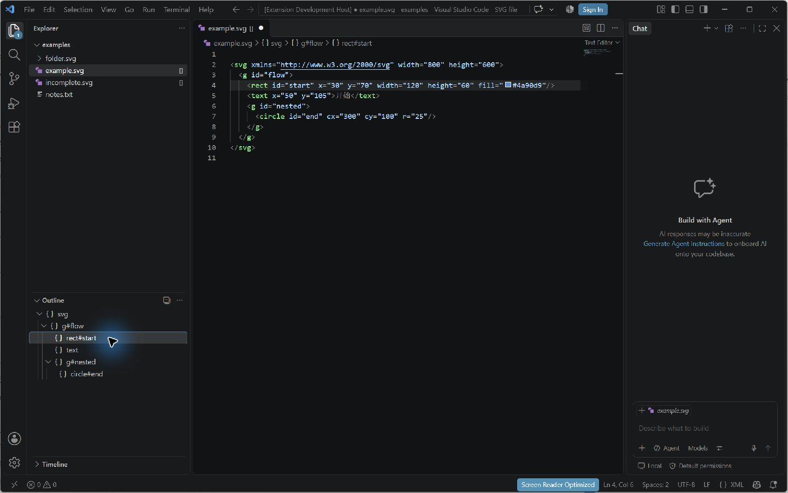
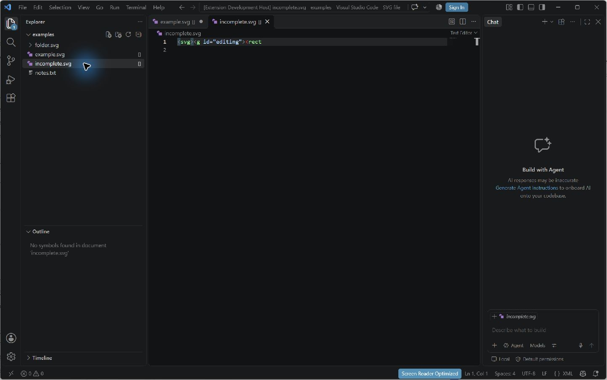

# PJ1 第二阶段：插件实践与插件式重构

## 架构方案

本项目包含独立 VS Code SVG 扩展和插件式 SVG CLI。默认 CLI 提供第一阶段六种图形及十九条命令；显式配置可启用 stats、dir、box、modified-star。第一阶段 final 固定为251127e69abb2512dc787efe6a92dd30ab9514d4，第二阶段交付版本为 `p2`。

### 模块职责与依赖

| 模块 | 职责及依赖 |
| --- | --- |
| src/core/public | 四个扩展点、ShapeNode/ShapeView、文档与会话协议、IO端口；仅相互依赖 |
| src/core/document、session、history | 通用结构校验、候选文档事务、串行执行、精确快照及undo/redo |
| src/core/cli、shapes、presentation、svg | 分词、注册分发、provider查询、通用树/show及SVG读写；不导入插件或宿主 |
| src/host、src/bootstrap | 组合根、通用模块加载器、终端与真实IO适配器；装配具体实现 |
| src/plugins/builtin | 六个BuiltinProvider实例、十九个BuiltinCommand实例；拥有内置语法/帮助/反馈 |
| src/plugins/command-stats、command-dir | 两个独立命令包；仅依赖公开协议 |
| src/plugins/shape-box | 复合模型、provider、两个属性处理器和类型标签 |
| src/plugins/tree-star | 保存内容基线及星号标签，状态在实例内 |
| src/plugins/builtin/legacy及旧路径导出 | 保留第一阶段API与几何实现；计入插件指标，新内核不导入旧路径 |
| extensions/svg-tools | 独立VS Code包，CLI不加载，不混入CLI指标 |

运行方向为宿主 → 内核与插件，插件 → core/public，内核 → 公开协议。核心分发器不枚举具体命令/类型；固定六类型Visitor只留在默认插件内部，用于适配原模型。新图形通过ShapeNode及provider提供行为、展示和编码，不增加Visitor方法。容器由isContainer/children/withChildren/validateChildren/assertUngroup表达，不绑定具体GroupShape。

第一阶段为集中工厂/命令表和固定Visitor；第二阶段将这些变化移到注册侧，复用候选副本、历史与封装模型。代价是兼容API与新运行路径暂时并存，总代码量增加；不以“内核行数下降”宣称总复杂度下降。

重构前后实际模块图均由脚本从历史import/export生成：[before.puml](../docs/metrics/before.puml)、[after.puml](../docs/metrics/after.puml)。第一阶段原始设计图另见 [原图](phase2/baseline/before.puml)。完整文件职责、三类物理行数、函数级圈复杂度及增量见 [自动报告](../docs/metrics/report.md) 与 [JSON](../docs/metrics/metrics.json)。

### 扩展点清单

以下路径相对src。接口均在core/public，同类注册名唯一。内部错误在CLI输出时统一加error:。

| 接口 / 职责 | 内核及应用实际调用位置 | 类实现 | 禁用或无命中时 | 违约与失败 |
| --- | --- | --- | --- | --- |
| ShapeProvider：创建、读回、编码、展示、反馈 | core/shapes/ShapeFactory.ts#create/read/forShape；core/svg/SvgCodec.ts#decode/encode；core/presentation/Presentation.ts#tree/show；BuiltinPlugin中反馈调用 | BuiltinProvider六实例、BoxProvider | 默认六类；create未注册类型报unknown shape type；未知SVG元素拒绝；未知data-kind的g降级普通g | 类型/ID不符报shape provider contract violation；重复ID、循环或不变量错误拒绝候选；读入失败保留原文档 |
| Command：名字、语法、帮助及执行策略 | core/cli/CommandDispatcher.ts#dispatch → Command.run → Session入口；help由BuiltinPlugin注册回调读取Extensions | BuiltinCommand十九实例、StatsCommand、DirCommand | 未加载命令不出现在help，调用报unknown command: &lt;name&gt; | 插件校验参数；执行错误不阻断后续队列；注册失败整批回滚 |
| TreeDecorator：行尾标签与实例状态 | core/presentation/Presentation.ts#tree → core/tree/TreeLabels.ts#append；core/session/EditorSession.ts#notify | BoxTypeDecorator、ModifiedStarDecorator | 空标签列表完全不增加字符；关闭可选标签时树与final字节一致 | 空白/多行标签报invalid tree label；观察者异常报告并停用该实例，不撤销已提交状态 |
| AttributeHandler：图形属性的领域语义 | BuiltinPlugin的set回调在Session.edit中调用core/attributes/AttributeDispatcher.ts#apply | BoxFillHandler、BoxLabelHandler | 无命中走ShapeNode.set原白名单，rect.fill可改，rect.label报unknown attribute | 多命中报attribute handler conflict；handles/apply异常即丢弃候选，不回退，不清空undo/redo |

ShapeProvider创建整棵脱离文档的子树；框架统一检查ID、对象归属、环和容器约束后提交。provider编码只提供有序属性/文本，通用writer处理转义与遍历。属性处理器只能修改当前候选文档，不能另发编辑命令；一次set仍是一个undo单元。

### 两种装配与配置格式

代码装配在组合根调用createRuntime({plugins:[{manifest,plugin,options}]})，plugin为类实例，manifest来自包清单。实际可运行示例见 [CodeAssembly.mjs](../scripts/acceptance/CodeAssembly.mjs)。

配置装配先构建，再执行：

```powershell
npm ci
npm run build
node dist/bootstrap/main.js --config plugins.config.json
```

无--config时只启用默认能力。根配置按stats、dir、box、modified-star顺序加载：

```json
{"plugins":[
  {"module":"./dist/plugins/command-stats"},
  {"module":"./dist/plugins/command-dir"},
  {"module":"./dist/plugins/shape-box"},
  {"module":"./dist/plugins/tree-star"}
]}
```

每项module为非空字符串；enabled缺省true，false完全跳过解析/求值；options原样传给activate。相对路径以配置文件目录为基准，包名通过该位置的Node createRequire.resolve解析后动态import；包通过main或exports通用入口公开JS文件。构建脚本通用复制package.json到dist，插件无需修改加载器。当前解析采用require条件定位入口，随后以import求值。

插件package.json声明name与contributes，四类名称列表为shapes/commands/decorators/attributes，缺省为空。例如box提供box、box-fill/box-label、box-type-label。默认导出支持提供activate的类实例或无参类。

A/B共用host/plugins/PluginLoader.activate → PluginRegistry.activate：暂存注册 → 激活返回 → 核对声明与实际类别/名称集合 → 一次发布。按顺序加载，重名、清单错误、激活失败不留下半注册状态，已成功插件保留，继续后续加载。上下文结束即关闭，迟到注册拒绝。

| 加载失败 | 输出 |
| --- | --- |
| 顶层模块不存在 | error: plugin not found: &lt;module&gt; |
| 无默认导出 | error: plugin has no default export: &lt;module&gt; |
| 清单不符 | error: plugin manifest mismatch: &lt;name&gt; (declared: …, registered: …) |
| 求值、依赖或激活失败 | error: plugin failed to activate: &lt;name&gt; (&lt;reason&gt;) |
| 同类重名 | error: duplicate registration: &lt;category&gt;/&lt;name&gt; |
| 配置语法或结构错误 | error: invalid plugin config |

这些加载诊断写stderr且主程序继续启动；配置非法时保留默认能力。模块内部缺依赖不误报顶层模块找不到。代码装配也不能绕过清单与回滚。

### 命令与目录适配器

stats使用只读Session.query，从画布子项按顺序DFS。叶子按类型首次出现顺序计数，g/box只计containers，内部叶子照计，根SVG不计；空文档输出(total 0, containers 0)，不进入历史。

dir同样为query，无文档即可调用，目录为宿主捕获的进程工作目录，read/save不改变它。目录先于文件，各组按UTF-16字符串顺序稳定排序；保留隐藏项，不递归，排除.与..。特殊项含符号链接显示[OTHER]并排在文件后，不遍历目标。标记后两个空格；空目录输出(empty directory)，读取失败由REPL输出error: cannot read directory: &lt;path&gt;后继续。成功和失败均不改变内容、路径、dirty及历史屏障。

Adapter角色：DirCommand为Client，core/public/Plugin.ts中的DirectoryReader/DirectoryEntry为Target，host/filesystem/LocalDirectoryReader为Adapter，node:fs/promises.readdir/Dirent为Adaptee。适配器将真实条目转换为name/kind，命令只消费端口，可独立注入替身；A/B使用同一命令与适配器。

### 四条ADR

**ADR-01 属性事务。** handles接收深只读ShapeView，apply接收当前候选EditDocument与目标。零命中用旧规则，一个命中执行，多个命中拒绝而不按顺序覆盖。命中后抛错不转默认路径。Session.edit在独立副本上执行并校验，成功后复制提交一个before/after历史单元；失败丢弃候选、保留redo，undo/redo整体恢复。代价是O(N)快照，插件必须遵守同步候选访问契约。

**ADR-02 box读回与结构保护。** box创建rect/text两个本地模板叶子，ID派生为&lt;id&gt;-rect和&lt;id&gt;-label，文字固定偏移(x+20,y+35)，矩形默认#4a90d9。全子树ID冲突整条失败。序列化为g+data-kind="box"；无插件降级普通g，有插件但必要直接子项缺失/类型错误则拒绝整个读入，重复ID始终拒绝。validateChildren保护必要部件免受delete/addto/group抽走；额外嵌套、重排和整体移动/删除允许，assertUngroup拒绝box。clone/withChildren保留子类型。降级后再保存不保留复合标记，是明确的语义损失。

**ADR-03 dirty与组合。** modified-star实例保存成功init/read/save的内容基线。新节点立即标星；比较自身类型/属性和直接子项有序ID，不把子属性变化向祖先传播；根行比较画布和整树。undo回保存内容清星，redo再次偏离恢复；失败与查询不更新基线，canvas修改不当作保存。属性键规范化避免排列噪声。标签按注册顺序空格连接，(box)与星号互不感知；状态在实例私有字段，无模块级变量。比较代价约O(N)，不缓存可变模型引用。

**ADR-04 激活后清单校验。** 每插件暂存，activate返回后核对四类集合，不允许漏报/多报/类别错报/重复声明。重名锁定当前批次失败，插件捕获异常也不能部分提交。A/B调用同一路径，失败继续加载后续。options由插件解释。注册回滚只覆盖框架注册，不承诺撤销任意外部副作用，因此激活契约禁止编辑文档或写文件。

### VS Code实践与演示

扩展位于extensions/svg-tools，独立npm ci/build后在VS Code打开该目录按F5启动开发宿主；示例位于examples。先观察原生TypeScript Outline，再实现SVG嵌套树；点击定位、当前缓冲区更新和不完整XML均已实际验证。详细启动步骤见 [扩展说明](../extensions/svg-tools/README.md)。

宿主负责Explorer/Outline、缓冲区、符号请求、导航和生命周期；extension.ts激活时注册SvgDecorationProvider与SvgSymbolProvider，并管理Disposable。调用方向分别为Explorer → FileDecorationProvider → workspace.fs.stat → FileDecoration，以及Outline → DocumentSymbolProvider → 当前文本 → XML树/偏移 → DocumentSymbol。根、容器和叶子均返回，节点有ID显示tag#id，无ID显示tag；不完整XML返回空树，修复后恢复。只给真实.svg文件加[]，不改文件名或内容，不装饰目录或普通文件。

Decoration是附加宿主元数据，体现组合，但provider没有包装一个同接口组件逐层委托，不能等同经典GoF Decorator。Adapter对应更直接：两个provider把文件类型和XML树转换为宿主所需的装饰/符号接口。CLI树标签也是按契约组合行尾文本，没有伪称为完整同接口包装链。

Phase 1解析器只支持严格六类型编辑子集，会检查尺寸/属性/唯一ID并补ID，且缺少源码范围；模型约束和固定Visitor也不适合任意未保存XML。大纲只复用层次遍历思想，采用独立保留位置的解析层，避免为了复用而引入错误语义。真实点击曾发现图片预览抢占定位，补入扩展的文本编辑器默认关联后修正；用户显式设置仍优先。



截图首行有未保存空行，所以rect在第4行；磁盘样例初始为第3行，宿主测试验证初始范围。



## 过程记录

| 节点 | 提交与结果 |
| --- | --- |
| 第一阶段冻结 | final → 251127e；逐字节基线未覆盖 |
| 基线与VS Code实践 | 8a48f12、ee75247；示例、截图、17项独立单元测试及真实宿主验证 |
| 公开契约/框架 | c0dd4e2、cf0e544；四点就位，7b92eb2固定首次历史指标 |
| 双装配 | 60e0f23；通用加载和失败恢复 |
| 命令插件 | 969ca05；独立stats/dir及真实目录组合 |
| box | c2a83b6；属性、结构和读回；本地A演示921b642 |
| 标签 | 4e8e80d；保存内容比较与双标签共存 |
| 统一验收 | 4408b4f；567项测试、12组A/B比较与提交差异证据 |

AI建议经实际代码与运行核验：没有将Decoration名称直接套成经典模式；没有复用CLI严格解析器做大纲；字节基线发现普通g的show误报children=0后改为真实视图数量。一次结构夹具误放根级导致既有ungroup限制，只修夹具，不改变生产规则。测试按改动范围执行，阶段结束统一验收，不因文档整理重复全量测试。

## 一致性自查

567项测试包括依赖边界检查：内核相对导入留在core，插件导入内核仅限public，不反向依赖host。所有业务扩展以类/实例注册，状态字段封装。

方式A提交921b642与B提交c2a83b6共享父969ca05。A只新增box并修改src/host/Runtime.ts；B只新增包和改配置，附测试文档。box包A/B差异为空。命令/星号B提交同样检查所有既有插件、内核与宿主无变更。先确认路径存在，再核对保护路径差异，避免空路径伪证据。命令接入仅额外增加通用构建清单复制和package构建元数据，未借此修改运行逻辑。

本地演示分支未推送；可从 [Git bundle](phase2/acceptance/diffs/box-code-demo.bundle) 恢复真实提交对象。完整SHA、路径清单、patch及空保护差异见 [差异清单](phase2/acceptance/diffs/manifest.json)。加载器经人工核对没有具体插件import、名称映射或业务分支，关键词搜索仅辅助。

指标由scripts/Metrics.ts从final与冻结历史提交4408b4f生成，不从工作树手填。三类完整计入兼容实现和旧路径导出，VS Code单列，排除依赖/测试/构建产物；物理LOC含注释空行，圈复杂度按统一AST口径按函数累加，规则与函数明细见 [指标说明](../docs/metrics/README.md)。后续报告提交不改变src，p2需与4408b4f源码内容摘要一致；不是以提交标题代替源码核验。

## 质量保证手段

统一验收：严格类型检查、构建、26文件567项测试通过；12组真实进程A/B会话未经归一化比较stdout/stderr、退出码、SVG文件名与内容一致。其中6组关闭全部可选插件，另对照final基线；其余覆盖课程基础/版本A/版本B、stats/dir与dirty历史，以及实际A/B历史提交各自构建。cli-1退出码1对应原会话预期错误。

dir使用固定临时目录，日志和配置在外，核对隐藏项和目录内容始终不变。单元测试覆盖替身/真实适配器、失败不变性、属性冲突/部分失败、标签状态机、加载四条失败路径与回滚。输入只存命令，输出与SVG分文件，SHA-256见 [验收清单](phase2/acceptance/evidence/manifest.json)。[复现步骤](phase2/acceptance/README.md) 包含演示bundle恢复及两历史工作树构建。

干净检出安装/构建与运行结果见 [最终检出记录](phase2/final-verification.md)。本阶段结论限于已实现SVG子集和已验证平台；未实现选做图形/导出扩展，不能据测试通过推断任意SVG或任意规模性能。最终报告与验证证据随 `p2` 交付。
