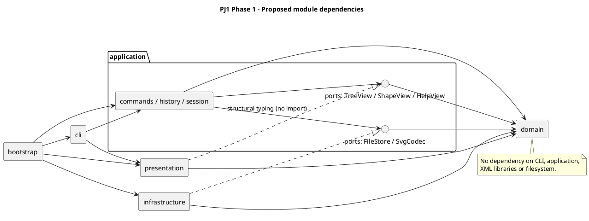

# PJ1 第一阶段：SVG CLI 编辑器架构与约定（已确认）

- 编写日期：2026-10-10。
- 需求依据：[phase_cli_1.md](../phase_cli_1.md)。
- 确认日期：2026-10-10；用户确认 D01 使用 `PJ 1` 作为仓库根目录，D02–D18 按原建议执行。
- 当前阶段：领域模型、应用历史、全部编辑命令与 CLI 解析/展示已完成并验证；init/canvas 已接入，SVG 文件读写待下一阶段实现。
- 本文中的“需求”来自阶段文档；“方案”及第 5 节的“已采纳规则”是本次确认后的实施依据；替代方案仅保留为取舍记录。
- 所有原有不确定事项集中在第 5 节，决策依据记录于第 7 节。D15 的依赖版本已在工程骨架阶段确定；D18 的实际截止时间仍需补充。

## 1. 范围与固定要求

### 1.1 本阶段范围

实现 TypeScript 面向对象 SVG 命令行编辑器，支持六种内置类型：`rect`、`circle`、`ellipse`、`line`、`text`、`g`。

| 分类 | 命令 | 历史行为 |
| --- | --- | --- |
| 文档 | `init`、`read`、`save`、修改尺寸的 `canvas` | 成功执行后禁止 undo/redo，直到下一次编辑重新解禁 |
| 编辑 | `create`、`delete`、`move`、`scale`、`set`、`group`、`ungroup`、`addto`、`front`、`back` | 一条成功编辑命令是一个撤销单元 |
| 显示 | `tree`、`show`、`help`、查询尺寸的 `canvas` | 不进入编辑历史 |
| 历史 | `undo`、`redo` | 新编辑发生后清空 redo 栈 |

`box`、插件加载系统、GUI、鼠标操作不在本阶段实现范围。`create box` 必须返回未知图形类型错误。需求中的复合图形专用 ungroup 错误属于后续阶段语义，本阶段不为此增加一个可创建的 box 类型。

### 1.2 固定交互与模型约束

1. REPL 使用 `svg>` 提示符，逐行读取输入。
2. 每个图形及 `g` 都有全局唯一、大小写敏感的 ID；画布根不是可编辑图形。
3. CLI 的 `create/group` 必须显式提供 ID；导入时缺失 ID 按标签名加序号补全并警告。
4. 坐标采用 SVG 坐标系，支持浮点数。
5. 带空格参数使用双引号。文本内容是 XML 子文本，不是 SVG 属性。
6. 错误一行一条，以 `error:` 开头；命令失败不改变任何状态。
7. 编辑成功输出结果摘要；显示命令输出对应内容。
8. `create ... in <containerId>` 支持全部六种类型；省略时挂到画布根。
9. 删除容器删除全部子孙；移动容器整体移动；缩放容器递归到子孙。
10. `scale` 同时缩放图形的位置与尺寸，因子必须为正数。
11. 样式省略时不写入属性，遵循 SVG 默认渲染行为。
12. `set` 只支持公共样式和各类型规定的几何属性，以及 text 的 `text` 内容；不支持通过 set 修改 ID。
13. `ungroup` 将子节点提升到原父容器中，占据原组位置；禁止解散 SVG 根的直接子容器。
14. `front/back` 只调整同级节点的绘制顺序。
15. 一类一文件，文件名等于类名；字段封装；几何行为通过类与多态实现。
16. 不采用公共数据袋加过程式函数的领域模型，不在各模块重复 `switch(tag)`。
17. 按名称分派只集中在命令分发与图形工厂两处，并在设计中标注为待重构点。

需求规定的错误字符串将直接作为测试依据，包括重复 ID、不存在的图形或容器、非容器目标、未知类型、非法分组、根级解组、非正缩放、文件读写失败、无文档和历史屏障。文档未规定的错误见 D12。

## 2. 架构方案

### 2.1 目录与模块职责

已确认工程与 Git 仓库根目录均为 `D:\Code\Software_Design\PJ 1`，不在上级 `Software_Design` 目录建仓。

```text
PJ 1/
├── src/
│   ├── domain/
│   │   ├── shapes/           # Shape、各叶子图形、GroupShape
│   │   ├── document/         # SvgDocument、ID 索引、文档快照
│   │   ├── factory/          # ShapeFactory：唯一的图形名称分派点
│   │   └── traversal/        # ShapeVisitor 等只读遍历协议
│   ├── application/
│   │   ├── commands/         # Command 与每个具体命令类
│   │   ├── history/          # HistoryManager、历史屏障
│   │   ├── ports/            # 展示接口；后续 FileStore、SvgCodec 接口
│   │   └── session/          # EditorSession：当前文档、路径、执行协调
│   ├── cli/                 # Tokenizer、CommandDispatcher、Repl
│   ├── presentation/        # TreeFormatter、ShowFormatter、HelpFormatter
│   ├── infrastructure/
│   │   ├── svg/             # XML 解析、SVG 读写 Visitor、SvgCodec 实现
│   │   └── filesystem/      # FileStore 的本地实现
│   └── bootstrap/           # 启动入口、具体依赖装配
├── tests/                   # 领域、应用、端到端测试和输入样例
├── examples/                # 命令脚本与可预览 SVG
├── doc/
│   ├── README.md            # 本文：方案、决策、过程、自查、质量保证
│   └── architecture.puml    # 架构图源文件
├── README.md                # 安装、运行、测试、示例
├── package.json
└── tsconfig.json
```

上述模块目录已建立，尚未实现的目录用 .gitkeep 保留。已有 CLI 解析/分发/异步循环、领域模型与快照，以及应用命令、历史和会话；tests/cli、tests/domain、tests/application、tests/presentation 存放对应测试。具体类名可以在实现时调整，但职责和依赖方向改变必须记录。

### 2.2 架构图

箭头表示左侧依赖右侧；端口属于应用层，基础设施实现端口。图源同时保存在 [architecture.puml](architecture.puml)。



### 2.3 依赖方向规则

| 模块 | 允许依赖 | 禁止依赖及原因 |
| --- | --- | --- |
| domain | 本模块和必要的语言标准能力 | 不依赖其他业务模块、Node 文件系统或 XML 库，保持领域行为独立 |
| application | domain、自身 ports | 不依赖 CLI、展示实现或具体基础设施，避免业务绑定输入输出方式 |
| presentation | domain | 不执行编辑、不读写文件，输出格式不影响业务状态 |
| cli | application、presentation | 不直接编辑领域对象，不读写 SVG 文件，不维护历史 |
| infrastructure | application/ports、domain、XML/文件库 | 不依赖 CLI、presentation 或具体应用命令 |
| bootstrap | 各模块的装配所需公开入口 | 不承载编辑规则和命令实现 |

跨模块仅通过明确的公开接口访问。测试可导入被测模块，但生产代码不得依赖测试。违反规则的依赖登记为待处理项，不能在自查时默认为允许。

## 3. 对象职责与设计模式

### 3.1 领域对象与 Composite

- `Shape`：封装 ID、公共样式，声明 `move/scale/set/accept/clone` 等统一协议。
- `RectShape/CircleShape/EllipseShape/LineShape/TextShape`：持有私有几何字段，实现自己的校验和几何行为。
- `GroupShape`：封装有序子节点，对 move/scale 递归调用统一协议；set 只改变容器自身样式，由 SVG 继承生效，不覆盖子节点显式样式（D07）。
- `SvgDocument`：封装画布、根节点集合、全局 ID 索引；提供插入、删除、迁移、查询与结构操作。

父子关系、索引和顺序只允许通过领域操作维护，不能让命令拿到可变 children 数组后自行拼接。父引用的具体表示可在实现时决定，但必须保证一节点一父级、无循环、索引与树一致。

组合操作规则先由文档验证和协调，再委托图形多态行为；不让每个命令重复识别图形类型。容器本身没有 x/y 等几何属性，不因统一接口而给 g 虚构坐标。

当前图形实现补充：

- `ShapeValidation` 集中校验 ID、有限数值、非负尺寸与正缩放因子；它是无 IO 的领域辅助类。
- `ShapeMutation` 封装预先计算的几何更新。move/scale 先构建所有更新计划，再应用；GroupShape 递归准备全部子孙计划，后部溢出不会留下前部修改。prepareMove/prepareScale 属于内部领域组合协议，应即时准备和应用，不跨其他编辑保存计划。
- Shape 的私有所有权记录维护父级，GroupShape 在构造前检查整棵候选子树的重复 ID 和直接子节点已有归属，全部成功后才建立新父级关系。构造方式不提供自引用入口，已归属节点不能被其他容器重复收编。
- GroupShape 拷贝并冻结外部传入的子数组；子图形仍可通过统一接口编辑。文档结构修改由 SvgDocument 集中协调，不向命令暴露可变数组。
- clone 复制具体类型、ID、几何、显式样式和顺序，重新建立克隆树内部的父级；克隆根不继承原父级，也不与原树共享图形。
- `set` 的属性名校验留在各图形类；这是该类型的属性白名单，不是按图形类型再次分派。

当前文档实现补充：

- SvgDocument 封装有限正数画布尺寸、只读根列表和全局 ID 索引，size 统计全部图形及容器；SVG 根不占用图形 ID。
- 所有结构修改先构建候选根和容器子列表，再遍历验证重复 ID、重复节点、循环与跨文档归属，随后统一提交冻结列表、父级和索引。成功操作保留已有节点对象引用，失败操作不修改这些引用及其状态；代价是每次结构修改 O(N) 的验证。
- Shape 通过 asGroup 多态表达容器能力，不按 tag 或 instanceof 分派。TreeAccess.ts 中的 Symbol 访问点仅供领域内部结构提交使用；应用命令必须调用 SvgDocument 公开用例，不能导入 TreeAccess 绕过索引。它是模块内部约定，不是对任意 JavaScript 反射调用的安全隔离。
- 节点的容器父级和文档归属分别记录；画布根节点没有容器父级，但仍归属于唯一文档。删除子树清除整棵子树的文档归属，只断开子树根的外部父级，内部关系保留，可再次插入。
- group 按原文档深度优先顺序收入目标；同父级在最早目标位置建组，跨父级在最早涉及的画布根之前建组；保留未被选中节点的相对顺序。
- ungroup 仅允许嵌套组，子节点原位提升，旧组变为空的脱离节点，其 ID 从文档索引移除。容器样式不会自动复制到提升的子节点，样式继承随最终 SVG 层级变化。
- DocumentSnapshot 封装独立图形副本，每次恢复再次复制；恢复完整画布、类型、属性、文本、样式、顺序、父级和索引。恢复会替换当前文档内的图形实例，调用方应重新按 ID 查询；原实例脱离文档，不会与恢复树共享。
- 此处仅实现领域操作与快照，不执行文件 IO，也不生成 undo/redo 栈；历史屏障和文件路径属于后续应用会话。

### 3.2 Command（课程必选）

每种编辑操作对应具体 Command 类。一条命令执行一次，形成一个历史单元。`HistoryManager` 负责 undo/redo 栈，不参与具体几何或结构规则。

文档与显示命令也通过应用层执行入口协调，但不加入编辑历史。命令分类是对象协议或元数据，不能通过反复比较命令名推断历史行为。

典型调用链：

```text
REPL → Tokenizer → CommandDispatcher → EditorSession
     → Command → SvgDocument / Shape
     → HistoryManager → CLI 输出
```

应用层返回结构化结果；CLI/展示层负责输出文字。领域对象不打印日志、不读取用户输入。

当前应用实现：

- `Command` 定义 execute 协议，`EditCommand/DocumentCommand/QueryCommand` 通过多态选择会话执行策略，不比较命令名，也不新增 switch 分派。
- `UndoableCommand` 包装一次编辑执行，提供 execute/undo/redo，并持有前后 DocumentSnapshot。每次执行创建独立包装，所以复用同一个命令对象也不会覆盖先前的历史。
- 编辑在候选文档上 apply；操作结果、撤销说明及快照全部准备成功后才恢复到当前文档。即使命令修改多个节点后抛错，原文档对象、父级与索引也不会被回滚替换，历史保持不变。
- `HistoryManager` 在成功执行、undo 或 redo 后更新栈；成功新编辑（包含无变化编辑）清空 redo；成功文档命令清空两栈并锁定历史。错误信息区分空历史与 IO 屏障。
- `EditorState` 封装文档与默认路径。DocumentCommand 在独立草稿上执行，成功后复制并提交，失败不改变文档、路径或历史。真实文件 IO 的原子写入仍属后续持久化阶段。
- QueryCommand 得到独立状态副本，执行后不提交，不改变 redo 或屏障。当前查询复制的成本为 O(N)，课程规模下优先保护状态，后续有性能需求时可改为只读视图。
- `EditorSession.execute/undo/redo` 串行排队，异步 IO 或编辑不会被后续命令越过；一次失败不阻塞后续输入。内部 executeEdit/executeDocument/executeQuery 仅供命令多态回调，调用方必须通过公开排队入口，不能直接调用这些钩子绕过串行策略。
- 会话成功编辑及 undo/redo 使用快照替换图形实例；公开 document getter 返回独立副本，读者与保留草稿不能修改当前状态。应用层按 ID 重新查询，不长期保存可变图形引用。
- `CommandResult` 封装并冻结成功摘要和警告，便于后续 CLI 展示。编辑命令可覆盖 describeUndo 给出具体恢复摘要；redo 复用已记录的结果，不重新执行操作。

当前十个编辑命令均已通过 CLI 接入 EditorSession 的候选执行与历史机制。init 和 canvas 修改走 DocumentCommand，canvas 查询、tree/show/help 走 QueryCommand；undo/redo 调用会话的串行历史入口。

基础编辑实现补充：

- CreateCommand 封装并复制类型、ID、参数和可选父容器 ID，注入集中 ShapeFactory；六种类型均可在创建时归属于 g。父容器校验与全局 ID 检查由 SvgDocument 执行。
- DeleteCommand 删除叶子或整棵容器子树，记录原父级用于恢复摘要；实际恢复使用历史快照，包含原位置、顺序与全部子孙。
- MoveCommand/ScaleCommand 使用统一领域操作。MoveDescription 通过 Visitor 生成各类型位置摘要；g 使用增量描述，不虚构位置。缩放撤销使用快照，摘要不计算倒数，避免极小正因子的倒数溢出。
- SetCommand 通过领域白名单修改属性，AttributeValueReader 使用 Visitor 读取修改前后值。数值反馈使用归一化结果；文本用 JSON 引号和转义保持单行。撤销原先不存在的样式属性时恢复缺省状态，摘要显示 `(unset)`，不强行写入 SVG 默认值。
- CommandResult 增加不可变的可选 undoMessage，基类优先使用它。每次执行的历史包装保存当次摘要，不把旧值放到可复用命令的可变字段中。
- 未改变几何或属性的成功编辑依然入栈并清空 redo；所有错误由会话转换为失败，不输出成功摘要、不修改文档或历史。

结构编辑实现补充：

- GroupCommand 复制并冻结目标 ID 数组，调用文档分组规则，回显新组与直接子节点数量；一次 undo 恢复全部原父级和位置，不借用受根级限制的 ungroup 来执行逆操作。
- UngroupCommand 记录解组前的直接子节点数量与父级，文档完成原位提升并移除组 ID；undo 通过快照恢复容器样式、全部子树和顺序。空嵌套组可解散，根级组与叶子会被拒绝。
- AddToCommand 将现有叶子或整棵容器子树追加到目标尾部，记录当次原父级的恢复摘要。已在目标内的节点仍移到尾部；自身/祖先移入子孙被拒绝。
- FrontCommand/BackCommand 只调用同级排序操作；子孙的层级、几何和样式保持。已在边界或仅一个节点的成功操作仍形成历史单元并清空 redo。
- 结构命令不直接访问 TreeAccess 或可变子数组，且不增加图形类型分派；非法目标、循环和分组冲突的校验由文档领域层集中承担。

### 3.3 Memento 与撤销方案（已采纳 D02）

采用 Command 配合完整文档快照：命令执行前后保存领域快照，undo 恢复前状态，redo 恢复后状态。快照是封装对象，通过各类 clone 能力复制，不通过 JSON 序列化丢失类行为，也不通过 SVG 文件读写生成快照。

优点是复杂分组、跨父级迁移和删除子树可精确恢复；代价是每次编辑约为 O(N) 的复制时间和存储开销。课程规模下建议优先采用该方式，后续确有性能需求时替换成局部快照或逆操作。

命令验证失败不得提交快照到历史；新编辑只有成功后才能清空 redo 栈。成功 IO 清空 undo/redo 栈并锁定历史；下一次成功编辑解锁，不能跨 IO 屏障撤销（D03）。

### 3.4 Factory 与名称分派限制

- `CommandDispatcher`：唯一的“命令名 → 命令创建逻辑”分派点。
- `ShapeFactory`：唯一的“类型名/标签名 → 图形类创建逻辑”分派点，CLI 创建和 SVG 导入共用。

两个分派点均标记为后续待重构：命令注册机制、ShapeProvider 类型注册接口是未来方向，本阶段只内置要求的命令和六种类型。

ShapeFactory 已实现唯一类型映射，集中管理六种构造方法、参数数量、数值解析与可选样式。当前接受解析后的 string/number 参数序列；parentId 是 CreateCommand 的独立参数，不在工厂内猜测 `in` 文本。SVG 读回将在后续通过该工厂创建图形，不在编解码器另建类型分派。

图形工厂可将不同输入转换为封装的创建请求，但不把文件读写和终端输出塞进工厂。SVG 导入遇到支持的标签后调用同一工厂；XML 库的节点种类处理不等于新增一套图形类型分派。

### 3.5 Visitor 用于只读展示与序列化

建议在领域层定义 `ShapeVisitor` 协议，各图形通过 `accept` 调用对应访问方法。`TreeFormatter`、`ShowFormatter`、SVG Writer 在各自模块实现该协议。

这样展示和导出无须 `switch(tag)`，领域类也不依赖具体 XML 库或 CLI 字符串。取舍是新增图形类型可能需要扩展 Visitor 接口；本阶段只有六种固定类型，可接受这一成本。未来插件阶段应重新评估动态类型与 Visitor 的兼容方式，不宣称当前方案已实现“插件新增内核代码为零”。

### 3.6 CLI 解析与查询展示（2026-10-13）

- Tokenizer 逐字符解析，Token 封装值与是否带双引号。引号必须包围完整参数，参数之间以空白分隔；引号内支持 D06 的两种转义，引号外反斜杠按字面保留。空行与整行注释返回空 token 列表，不解析注释内的引号。
- CommandDispatcher 用唯一命令表完成名称分发、通用参数数量检查与命令装配；create 只检查参数尾部未加引号的 `in <containerId>`，不把类型名/ID 或加引号的 `"in"` 当作子句。各类型参数数量和数值仍由集中 ShapeFactory 校验，不在 CLI 复制类型表。
- Repl 等待每条异步命令完成，先输出警告再输出结果；异常压为单行并继续下一行，任何命令失败使最终退出码为 1。多行 tree/show/help 输出保留换行。EOF 前已读入的最后一行即使没有换行符也执行。
- TreeFormatter 通过 Visitor 显示六种图形的几何及显式样式，用树枝连接符保留顺序和层级；支持空文档、整棵树、容器子树与单叶子。ShowFormatter 展示真实父级、完整几何字段、文本、组的直接子节点数量及自身显式样式。文本使用 JSON 引号转义，避免内容换行破坏结构；不把继承样式写成节点自身属性。
- TreeCommand/ShowCommand/HelpCommand 只依赖应用层 TreeView/ShapeView/HelpView 结构接口，bootstrap 注入具体 Formatter。presentation 不导入 application，靠 TypeScript 结构类型满足接口，因此原依赖方向保持；查询使用会话副本，不进入历史或解除屏障。
- 为使本阶段 CLI 可从空会话开始运行，将无文件 IO 的 InitCommand、ResizeCanvasCommand、CanvasQueryCommand 提前到步骤 7；read/save 留在步骤 8。本阶段 read/save 校验参数后返回 `command not implemented yet: <name>`，help 明确标记待实现，不改变文档或历史。
- 细化可选画布参数：init 支持 0/1/2 个参数，省略的宽高分别取 800/600；canvas 无参数查询，给一个参数只改宽度并保留当前高度，给两个参数修改两维。尺寸校验仍走领域规则，成功修改（含尺寸相同）建立文档屏障。成功 init 清空默认路径，resize 保留路径；失败均保留原状态。

## 4. 状态、事务与变化点

### 4.1 必须保护的状态

失败原子性覆盖当前文档、画布尺寸、图形字段、父子关系、绘制顺序、ID 索引、默认文件路径、undo/redo 栈和历史屏障状态。

建议执行顺序为：解析参数 → 校验全部前置条件 → 准备候选状态 → 提交状态与历史 → 输出成功结果。读取文件应先构建并验证临时文档，成功后替换当前文档。自动补 ID 的警告建议在完整导入成功后集中输出，避免失败导入给人已生效的印象。

保存操作对外部文件的保护方式见 D14；不能把内存原子性等同于磁盘写入原子性。

### 4.2 变化点假设

| 可能变化的部分 | 本阶段留下的边界 | 暂不做的扩展及理由 |
| --- | --- | --- |
| 新命令 | Command 对象、集中分发 | 不做动态插件加载，当前命令集合固定 |
| 新图形/box | 统一 Shape、Composite、集中工厂 | 不提前实现 ShapeProvider；插件协议需结合后续要求设计 |
| GUI/agent 输入 | CLI 与应用层分离 | 不写 GUI、网络服务或鼠标事件 |
| SVG/XML 库或存储方式 | SvgCodec/FileStore 端口 | 不添加数据库和云存储适配器 |
| tree/show 格式 | 独立展示模块与 Visitor | 不实现主题或国际化系统 |
| 撤销性能 | HistoryManager 与快照边界 | 不先做增量优化；确认性能问题后再替换 |
| 导入范围 | 显式支持矩阵与读写测试 | 不宣称兼容任意外部 SVG |

## 5. 已确认决策（集中清单）

用户于 2026-10-10 明确确认：“D01 PJ 1作为仓库根目录；其他按照建议的来。”以下 D01–D18 均已采纳，执行时以“已采纳规则”为准。替代方案不参与当前实现，后续变更需记入修订记录。

| 编号 | 决策事项 | 已采纳规则 | 未采纳的替代方案与影响 |
| --- | --- | --- | --- |
| D01 | 仓库根目录 | 使用 `PJ 1/` 为独立仓库根 | 使用整个 `Software_Design/` 会把其他课程项目纳入本仓库，需额外目录约定 |
| D02 | 撤销实现方式 | Command + 完整领域快照；先保证精确恢复 | 每命令局部快照/逆操作，内存更低，但结构命令实现与验证更复杂 |
| D03 | IO 屏障后是否保留旧历史 | 成功 IO 后清空两栈并锁定；下一次成功编辑解锁，undo 仅能回到该 IO 后状态 | 保留旧历史、解锁后允许跨屏障撤销；需明确 read/init 换文档后旧命令如何安全执行 |
| D04 | 跨父级 group 的新组位置 | 同父级：原父级中最早被选节点的位置；跨父级：画布根中最早涉及的根节点之前 | 跨父级统一放根末尾更简单；放最低公共祖先更自然，但定位规则更复杂 |
| D05 | group 的“保持相对顺序”如何解释 | 所有目标按操作前文档深度优先顺序排列；拒绝重复 ID 和祖先/子孙同时参与 | 按参数顺序排列更易手工控制，但可能不符合“保持相对顺序”的要求 |
| D06 | 分词转义和空字符串 | 支持 `\"`、`\\`；允许 `""` 作为空文本；未知转义报错；仅整行首个非空白字符为 # 时是注释 | 完全不支持转义更简单，但无法自然输入带引号文本；行内注释会与颜色值冲突 |
| D07 | g 的 set 样式语义 | 只设置 g 自身的 fill/stroke/stroke-width，由 SVG 继承生效；已有子元素显式样式保留 | 递归覆盖子元素会改变显式样式，并增加撤销状态；文档未明确要求传播 |
| D08 | 输入数值范围与溢出 | 仅有限数值；坐标可负；画布尺寸正数；宽高/半径/stroke-width 可为零但不可负；执行前检查运算结果有限 | 要求尺寸全部正数可减少退化图形，但限制 SVG 合法的零尺寸；允许负尺寸会产生无效渲染 |
| D09 | 外部 SVG 支持范围 | 接受六种标签、规定属性、根 width/height/viewBox；支持 XML 注释和命名空间；未知元素、未知属性、非恒等 viewBox 或 transform 明确报错；根尺寸只支持数值或 px | 忽略未知内容容易丢失信息；保留未知属性或解析变换更兼容，但显著扩大范围 |
| D10 | ID 合法性与自动补全 | CLI ID 为非空、无空白字符串，保持大小写；导入先收集全部显式 ID，重复报错，缺失 ID 按各标签从 1 递增并跳过占用值；空 id 按缺失处理 | 更严格的 XML ID 规则可能限制用户命名；一次遍历补 ID 容易与后面显式 ID 冲突 |
| D11 | save 的默认路径与相对路径 | read 成功记住路径；显式 save 成功更新默认路径；init 清空路径；无路径保存且无默认路径报错；相对路径基于进程工作目录 | 显式 save 不更新默认路径也可行，但下次 save 可能写回旧文件；相对路径基于输入 SVG 目录需额外说明 |
| D12 | 未规定的错误与无文档例外 | help/空行/注释/EOF 无文档时可用；其他需要文档的命令报规定错误；新增错误使用稳定的一行英文消息 | 严格解释“其他命令”会使 help 无文档不可用，与启动提示冲突。空历史、非法参数、非法 XML 等需在实现前形成字符串清单 |
| D13 | 成功但无变化的编辑 | 视为成功编辑，进入一个历史单元并清空 redo，例如 move 0 0、已在最前的 front | 无变化不进入历史更省空间，但必须定义是否重新解锁历史、是否清空 redo；实现需更多状态比较 |
| D14 | 保存时覆盖已有文件 | 显式 save 默认覆盖；尽可能先写同目录临时文件，再安全替换目标；失败不更新路径与历史 | 直接写目标更简单，但中途失败可能损坏已有文件；自动询问覆盖会影响脚本回放。替换需验证 Windows 行为 |
| D15 | 技术工具与工程检查 | Node.js + npm；TypeScript strict；使用成熟 XML 解析库；采用 Vitest 或同等级测试框架；锁定依赖并提交锁文件 | 具体版本和 XML 库在实现前检查本机环境及维护状态后再定；手写 XML 解析风险较高 |
| D16 | CLI 退出与脚本错误 | EOF/Ctrl+C 退出；不增加课程未列出的 quit 命令；脚本中出错继续下一行，但最终进程返回非零状态 | 首错退出便于自动化定位，但不符合交互“错误后继续”的直觉；始终零退出不利于自动验收 |
| D17 | addto 自身/祖先与重复归属 | 自身或移入子孙一律报错；已属于目标容器时仍移至末尾，符合“最后一个子节点” | 已属于目标时直接报错或无变化也可，但需统一成功反馈及历史行为 |
| D18 | 最终截止时间和分支策略 | 用户提供课程截止时间；主分支使用 main；分步提交并推送，最终提交标记 final | 当前需求未给出截止时间，无法确认标签是否按时；后续如远端出现新历史，先拉取协调，禁止强制覆盖 |

D09 已确认本阶段拒绝 transform，不支持导入背景中的带变换示例。支持六种类型的 SVG 子集，不承诺兼容任意外部 SVG；后续若增加变换支持，应另行记录范围修订并补充测试。

### 5.1 SVG 导入与属性支持矩阵（落实 D09）

| 元素 | 支持的属性/内容 | 处理规则 |
| --- | --- | --- |
| svg 根 | SVG 命名空间、width、height、viewBox | width/height 为有限正数或 px；省略 viewBox 按画布尺寸解释，存在时只接受 `0 0 width height`；不为根分配图形 ID |
| rect | id、x、y、width、height、fill、stroke、stroke-width | 按 SVG 几何默认值解释缺省属性，尺寸非负 |
| circle | id、cx、cy、r、fill、stroke、stroke-width | 按 SVG 几何默认值解释缺省属性，半径非负 |
| ellipse | id、cx、cy、rx、ry、fill、stroke、stroke-width | 按 SVG 几何默认值解释缺省属性，半径非负 |
| line | id、x1、y1、x2、y2、fill、stroke、stroke-width | 坐标允许负值 |
| text | id、x、y、fill、stroke、stroke-width；子文本 | 保留文字内容与空白，不支持 tspan 等子元素 |
| g | id、fill、stroke、stroke-width；受支持的子图形 | 维护子节点顺序，拒绝 transform |

图形几何值只接受有限数值；根 width/height 缺失时因无法确定画布而拒绝。XML 声明、注释与结构缩进不作为图形；未知元素/属性不忽略、不透传，整次 read 失败且当前状态不变。SVG 标准命名空间声明属于 XML 结构信息，不作为未知图形属性。颜色字符串不做完整 CSS 解析。

### 5.2 补充错误清单（落实 D12）

需求已规定的错误文本保持不变。以下针对需求未规定的错误制定稳定输出；`<...>` 表示实际参数值。

| 情况 | 输出 |
| --- | --- |
| 未知命令 | `error: unknown command: <name>` |
| 参数数量或结构错误 | `error: invalid arguments. usage: <syntax>` |
| 引号未闭合 | `error: unterminated quoted string` |
| 未知转义 | `error: invalid escape sequence: <sequence>` |
| 引号未独立包围参数 | `error: expected whitespace before quoted string` / `error: expected whitespace after quoted string` |
| 非法或非有限数值 | `error: invalid number: <value>` |
| 数值范围或运算结果非法 | `error: invalid value for <attribute>: <value>` |
| 空历史（不在 IO 屏障状态） | `error: nothing to undo` / `error: nothing to redo` |
| 无默认保存路径 | `error: no save path. use 'save <file.svg>' first` |
| 非法 SVG/XML 内容 | `error: invalid svg: <reason>` |
| 导入元素或属性不支持 | `error: unsupported svg element: <tag>` / `error: unsupported svg attribute: <attribute>` |
| viewBox 不支持 | `error: unsupported svg viewBox: <value>` |
| 非法 ID | `error: invalid id: <id>` |
| group 参数含重复目标 | `error: duplicate group target: <id>` |
| addto 形成循环 | `error: cannot add a container into itself or its descendant: <id>` |
| ungroup 目标是普通叶子 | `error: not a container: <id>` |

领域 API 另有结构前置校验：`invalid insertion index: <index>`、`shape already has a parent: <id>`、`shape already belongs to a document: <id>`、`group requires at least one shape`。CLI 后续仍先按已列命令语法校验，避免暴露不适用于用户命令的内部状态。

错误只输出一行，底层 XML/文件异常不直接输出堆栈；多个错误同时存在时按解析、文档存在性、参数与目标校验、执行的顺序报告第一个失败原因。缺失文件/读写权限使用需求指定的 cannot read/write file 错误，非法文件内容使用 invalid/unsupported SVG 错误。

## 6. 分步实施与验收计划

以下为分步计划；工程骨架、领域模型、命令历史、全部编辑命令和 CLI 分词/分发/展示已完成，接下来实现 SVG 读写。用户要求每次提交、推送前先询问；结构编辑已按授权提交推送，当前 CLI 阶段改动尚未提交或推送。截止时间待用户提供。

| 步骤 | 工作 | 验收条件 | 建议提交主题 |
| --- | --- | --- | --- |
| 1 | 审阅本文，逐项确定 D01–D18，补充错误清单和导入矩阵 | 决策无相互矛盾，未决事项有明确影响范围 | doc - 确认架构与行为约定 |
| 2 | 检查环境与远程历史；建立工程与 Git | 不覆盖远程历史，依赖可安装，空 CLI 可启动 | feature - 搭建工程骨架与测试工具链 |
| 3 | 领域模型、ID 索引、树结构、快照能力（图形与文档两个开发步骤均完成） | 图形多态行为、唯一 ID、无循环、删除和恢复子树正确 | feature - 实现图形领域模型 / feature - 实现文档与树结构管理 |
| 4 | Command、HistoryManager、会话协调（机制已完成，具体命令后续加入） | 单元粒度、undo/redo、失败不变性正确 | feature - 实现命令历史与会话协调 |
| 5 | create/delete/move/scale/set（应用 API 已完成，CLI 后续接入） | 六种图形及容器行为，参数错误和撤销通过 | feature - 实现基础图形编辑命令 |
| 6 | group/ungroup/addto/front/back（应用 API 已完成，CLI 后续接入） | 父级、顺序、循环检查及完整恢复通过 | feature - 实现结构编辑命令 |
| 7 | 分词、分发、REPL、tree/show/help；提前接入无文件 IO 的 init/canvas（已完成） | 引号、颜色、中文、注释、树形输出、终端编辑与屏障正确 | feature - 完善命令行解析与展示 |
| 8 | SVG 编解码、文件适配、read/save 文档命令 | 导入临时验证、补 ID、round-trip、历史屏障通过 | feature - 实现 SVG 文件读写 |
| 9 | 集成示例、回归测试与修正 | §6 会话与 §6.1 版本 A 能回放；浏览器预览正确 | test - 增加完整验收场景 |
| 10 | 更新过程记录、依赖自查、运行说明 | 文档描述符合实际代码，未通过项如实列出 | doc - 完成交付文档与一致性自查 |
| 11 | 干净检出验证、最终推送与标签 | final 指向最终提交，远程可见且满足截止时间 | 最终提交后创建并推送 final |

每个主题可拆成多个有意义的小提交，禁止把全部实现集中为一个最终提交。功能实现与 final 标签按后续里程碑推进。

## 7. 过程记录与修订记录

### 7.1 已发生的讨论

| 日期 | 讨论/发现 | 处理与当前状态 |
| --- | --- | --- |
| 2026-10-10 | 用户要求先阅读阶段文档并输出详细计划，不开始实现 | 已阅读需求并给出分步计划；未创建业务代码 |
| 2026-10-10 | 初步计划没有把若干模糊语义完全确定，包括历史屏障和跨父级分组 | 初版列出 D01–D18 供评审；用户随后全部确认采用建议 |
| 2026-10-10 | 需求背景有 transform 示例，但命令细则要求几何属性递归缩放 | 将导入支持范围单列为 D09，避免宣称实现了任意 SVG 读写 |
| 2026-10-10 | 多处按类型分派会违反课程范式限制 | 方案集中工厂，并建议用 Visitor 处理显示/序列化；尚未代码验证 |
| 2026-10-10 | 用户确认 PJ 1 为仓库根，其余事项按建议执行，并要求建仓连接远端 | 决策表转为已确认；落实导入矩阵与补充错误清单；本轮办理 Git，不开始业务实现 |
| 2026-10-11 | 用户要求按设计完成工程骨架，自行测试，提交推送前先询问 | 建立模块目录、严格 TypeScript 工具链、启动入口和 REPL；仅保留命令分发占位，未实现图形或编辑业务 |
| 2026-10-11 | 骨架需要证明源码入口与编译产物均可运行，而非只检查配置文件 | 添加真实 CLI 子进程测试；另行检查 npm run cli、npm start 和编译产物连续错误行为；验证锁文件重装后 check 通过 |
| 2026-10-12 | 用户要求继续下一开发步骤 | 完成五种叶子图形、GroupShape、Visitor、字段封装、属性校验与深复制；暂未实现文档根和全局索引 |
| 2026-10-12 | 递归修改如果边遍历边赋值，后部节点溢出会造成部分更新 | 采用两步几何更新计划；测试覆盖叶子后部字段和嵌套后部节点溢出，失败时原状态保持 |
| 2026-10-12 | 完整测试首次运行的 CLI 子进程无法取得沙箱账户用户信息 | 93 项领域测试通过；改用本地账户运行完整 check 后，96 项测试、类型检查与构建全部通过，未改动 CLI 逻辑 |
| 2026-10-12 | 用户要求继续文档与树结构阶段 | 实现画布、全局索引、结构事务、分组迁移排序和独立快照；保持领域层无 IO，不提前实现命令历史 |
| 2026-10-12 | 根节点没有容器父级，单靠 parent 无法阻止两个文档共享同一节点 | 增加独立文档归属记录；删除和恢复时释放旧树归属；测试覆盖跨文档共享拒绝与脱离子树再使用 |
| 2026-10-12 | 首轮新增分组测试误把未插入文档的节点写进期望顺序 | 对照测试构造修正预期，补充迁移失败与恢复旧树归属测试；完整 146 项测试、类型检查和构建通过 |
| 2026-10-12 | 用户授权提交推送文档树管理，并开始命令历史阶段 | 上一阶段已完成提交推送；新增命令抽象、执行包装、历史管理与会话，新阶段提交需再次确认 |
| 2026-10-12 | 如果命令在当前文档上执行后抛错，仅恢复快照会替换原对象引用 | 改为在候选文档中执行并在全部成功后提交；测试验证失败前后的原对象引用不变，redo 未清空 |
| 2026-10-12 | 异步文档读取或编辑可能被后续输入越过，命令也可能保留草稿引用 | 会话串行排队，成功后提交独立副本；补测异步顺序、失败队列恢复与保留草稿隔离；176 项测试通过 |
| 2026-10-12 | 用户授权提交推送命令历史，并继续基础编辑阶段 | 上一阶段已提交推送；实现集中工厂和五个真实编辑命令，仍不提前接入 CLI 解析 |
| 2026-10-12 | 不同图形的移动位置及 set 旧值如果按 tag 处理，会新增类型分派点 | 使用 MoveDescription 与 AttributeValueReader 两个 Visitor，保持名称分派只在工厂和命令分发边界 |
| 2026-10-12 | 缺省样式的撤销、极小缩放的逆变换摘要、命令对象复用可能产生不准确反馈 | 每次结果记录原值摘要，真实撤销走快照；补测缺省恢复、极小因子和复用命令，321 项测试通过 |
| 2026-10-12 | 用户授权提交推送基础编辑，并继续结构命令阶段 | 上一阶段已推送；加入五个结构命令，复用文档校验与历史包装，新阶段提交需再次确认 |
| 2026-10-12 | 根级组禁止 ungroup，但 undo 必须能撤销它的创建 | GroupCommand 逆操作继续使用精确快照；测试区分用户解组限制和历史恢复，混合结构序列可以完整撤销重做 |
| 2026-10-12 | 已在目标组或排序边界的操作可能被误判为无需历史 | 按 D13/D17 仍视为成功编辑入栈并清空 redo；363 项测试通过 |
| 2026-10-13 | 用户要求继续下一阶段；CLI 需要从无文档状态开始编辑 | 完成步骤 7，并将无文件 IO 的 init/canvas 提前接入；read/save 保留待实现提示 |
| 2026-10-13 | create 的 in 尾缀可能与文本或 ID 重名；异步执行需要保持脚本顺序 | 分词保留引号信息，只从参数尾部识别子句；REPL 逐条 await，并测试 EOF 最后一行、错误后继续与异步输出 |
| 2026-10-13 | 查询命令需要展示能力，又不能依赖具体展示实现 | 应用层定义结构接口，bootstrap 注入 Formatter，presentation 保持仅依赖 domain；通过 Visitor 输出树与属性 |
| 2026-10-13 | 完成 CLI 与中文流程图回放 | 14 个测试文件、436 项测试、类型检查和生产构建通过；增加可运行的 examples/flowchart.cli |

记录真实讨论和修正，不编造用户审阅意见、测试结果或 AI 发现过程。

### 7.2 决策与修订登记

| 决策编号/修订项 | 用户决定 | 理由 | 影响模块/测试 | 状态 |
| --- | --- | --- | --- | --- |
| D01 | PJ 1 为独立仓库根 | 用户明确指定，避免混入其他课程项目 | 工程目录、Git 管理 | 已确认 |
| D02–D08 | 采纳第 5 节规则 | 用户批准原建议；保证精确撤销、结构顺序和输入边界 | 领域、Command、history、CLI | 已确认 |
| D09–D14 | 采纳第 5 节规则，明确 SVG 子集和错误清单 | 用户批准原建议；避免静默丢失 SVG 信息并保持失败原子性 | SVG 编解码、文件、会话、验收测试 | 已确认 |
| D15–D17 | 采纳第 5 节规则；D15 工具版本已确定 | 用户批准原建议；依赖已安装并锁定 | 工具链、REPL、结构命令 | 已确认，D15 已落实 |
| 工程骨架 | 建立已确认的模块目录，先实现启动和 IO 循环 | 不提前实现领域规则或新增名称分派位置 | bootstrap、CLI、测试与工具链 | 已完成并验证 |
| 图形领域模型 | 在既定 shapes/traversal 模块加入校验与两步几何更新辅助类 | 保证复合操作失败原子性，深复制保持对象行为 | 六种图形、Visitor、领域测试 | 已完成并验证 |
| 文档树管理 | 在既定 document 模块实现文档与快照，结构变更通过领域内部 Symbol 协调 | 同步维护树、索引、父级和文档归属，不开放普通可变子列表 | SvgDocument、DocumentSnapshot、Shape/GroupShape、领域测试 | 已完成并验证 |
| Command 与历史 | 采用多态命令分类、执行包装与候选状态提交 | 一次执行一个历史单元，失败不改变原状态，异步执行保持输入顺序 | commands/history/session 与应用测试 | 已验证，基础命令已加入 |
| 基础编辑 | 集中工厂加五个具体 EditCommand；结果记录当次撤销摘要 | 避免类型重复分派和可复用命令的旧值覆盖 | factory、基础命令、两个 Visitor、测试 | 已完成并验证，CLI 已接入 |
| 结构编辑 | 五个具体命令复用文档规则与历史快照 | 每次一个撤销单元，精确恢复原父级、顺序、子树和容器样式 | 结构命令与应用测试 | 已完成并验证，CLI 已接入 |
| CLI 与展示 | 在既定分词/分发/展示模块实现；新增三个应用展示接口 | 保留两处名称分派和原有依赖方向；应用查询可以注入展示实现 | CLI、presentation、ports、查询命令、启动与测试 | 已完成并验证 |
| 步骤 7/8 顺序微调 | 无文件 IO 的 init/canvas 提前到步骤 7 | 让 CLI 可独立初始化和编辑；文档屏障规则不变 | 初始化、画布命令与 CLI 回放 | 实施记录，read/save 仍属步骤 8 |
| 可选尺寸细化 | init 缺省维度用 800/600；canvas 单参数保留当前高度 | 落实两个独立可选位置参数，不额外修改未指定的当前高度 | init/canvas、help、运行说明与测试 | 实施细化，已测试 |
| D18 | main 为主分支，分步提交推送，最终打 final | 用户批准流程；实际截止时间尚未提供 | Git 与交付验收 | 流程已确认，截止时间待补充 |

## 8. 一致性自查

当前完成工程骨架、领域模型、集中工厂、应用机制、全部编辑命令和 CLI 解析展示。自查只覆盖已有代码；持久化仍待实现验证。

| 检查 | 方法 | 当前状态 |
| --- | --- | --- |
| 实际目录与方案一致 | 对比 src 目录和模块职责，差异写入修订记录 | 已有模块目录一致，业务空目录保留 .gitkeep |
| 一类一文件、字段封装 | 检查类文件与可变字段访问 | 已有类各一文件；图形字段、画布、索引与快照副本私有；roots/children 冻结；main 仅装配 |
| 依赖方向符合规则 | 抽查 imports，特别检查 domain/application 是否导入 CLI、文件或 XML 实现 | domain 仅依赖自身；application 仅依赖自身与 domain，无 Node/CLI/XML/具体基础设施依赖 |
| 仅两处名称分派 | 搜索 switch、tag/type 比较及类型映射，人工判断是否形成重复分派 | 工厂集中类型映射；摘要和属性读取走 Visitor；无重复 tag/switch/instanceof 分派 |
| Command 与 Composite 真实落地 | 检查具体命令和容器多态行为，结合测试结果 | 十个编辑命令与可撤销包装已测试；整组编辑、跨级迁移和恢复均保持子树语义 |
| 文档与实际行为一致 | 对照决策表、CLI 输出和 SVG 支持矩阵 | CLI 编辑/查询、空文档和历史屏障已有回放；SVG 支持矩阵待持久化实现后验证 |

## 9. 质量保证手段与验收清单

采用领域测试、应用测试、CLI/文件端到端测试，并执行类型检查和构建。测试验证外部行为和领域约束，不为每个 getter 编写机械重复测试。

- [ ] 六种图形创建、属性白名单、浮点与边界数值。
- [ ] 全局 ID 大小写敏感、重复检测、删除后索引一致。
- [ ] 所有 create 类型支持 in；目标不存在或非 g 时错误正确。
- [ ] 嵌套容器 move/scale 递归，位置和尺寸同时缩放。
- [ ] set 文本与样式符合最终决定，未设置样式保持缺省。
- [ ] group 同父级/跨父级顺序、重复目标、祖先子孙冲突。
- [ ] ungroup 原位提升及根级禁止解组。
- [ ] addto 防循环，front/back 保持其他同级节点相对顺序。
- [ ] 每条编辑一个撤销单元，删除/分组/迁移可精确恢复。
- [ ] undo 后成功新编辑清空 redo；失败编辑不破坏 redo。
- [ ] 文档命令成功建立屏障；失败不改变路径、历史或文档。
- [ ] 查询和显示不进入历史、不破坏 redo。
- [ ] 引号、空格、中文、颜色、空行、注释和非法参数。
- [ ] XML 转义、命名空间、嵌套结构、绘制顺序和缺省样式。
- [ ] 缺 ID 补全及警告，不与后部显式 ID 冲突。
- [ ] 非法 XML、重复 ID、支持范围外内容、文件不存在或写入失败。
- [ ] 保存后读回的领域状态等价，不要求 XML 字节逐字一致。
- [ ] 文档 §6 完整会话和 §6.1 版本 A 流程图回放。
- [ ] create box 报未知类型；不把阶段二示例作为本阶段通过条件。
- [ ] 浏览器预览导出 SVG，检查中文、几何位置、样式与层级效果。
- [ ] 干净检出可安装、类型检查、测试、构建和运行。
- [ ] 分步 Git 历史、远程提交、final 标签和截止时间验证。

覆盖率只辅助发现遗漏。最终质量结论应填写实际运行命令、结果、已知限制和未通过项；上面的完整业务清单尚未通过。

### 9.1 工程骨架验证（2026-10-11）

工具版本已固定：TypeScript 7.0.2、Vitest 5.0.3、tsx 4.23.15、fast-xml-parser 5.11.2、@types/node 22.20.5。运行环境为 Node.js 22.17.1、npm 10.9.2，依赖锁文件已生成。

| 检查 | 结果 |
| --- | --- |
| npm ci | 按锁文件重装成功；安装审计报告 0 个已知漏洞 |
| npm run typecheck | 源码、测试与 Vitest 配置通过严格类型检查 |
| npm test | 1 个测试文件、3 项测试全部通过 |
| npm run build | 仅编译 src 到 dist，产物不包含测试和测试配置 |
| npm run cli | 启动横幅和 svg> 正常，EOF 返回 0 |
| npm start | 编译后 JavaScript 可启动，EOF 返回 0 |
| 编译产物连续错误输入 | 两条未知命令都输出错误，继续读取，EOF 返回 1 |
| npm ci 后 npm run check | 类型检查、3 项测试、构建全部通过 |

当前非空命令（包括 help、init）均被占位分发器拒绝；这是本次骨架的范围限制，不是最终命令实现。空行和整行注释可直接回放，真实编辑功能及 XML 读写仍待后续阶段。

### 9.2 图形领域模型验证（2026-10-12）

`npm run check` 已通过：严格类型检查、4 个测试文件中的 96 项测试、生产构建。其中 93 项为本次领域测试，3 项为既有 CLI 回归测试。

- 五种叶子的移动、缩放、几何属性白名单与公共样式。
- 有限数值、浮点、负坐标、零尺寸、非法 ID、负尺寸、非正缩放和数字字符串校验。
- 嵌套 GroupShape 保持对象引用和顺序，递归操作位置与尺寸；stroke-width 不随几何缩放。
- 叶子后部字段与嵌套后部子节点运算溢出时，不留下任何局部几何修改。
- 容器显式样式不覆盖叶子样式；缺省样式不自动填入。
- 构造子树时的重复 ID、重复对象与已有父级检查，失败不改变候选节点归属。
- 深复制的具体类型、文本、样式、子节点顺序、内部父级与对象独立性。
- Visitor 六种访问方法及嵌套遍历，不依赖 switch(tag)。

这不代表全局 ID 唯一、文档树迁移或 CLI 编辑已完成；这些属于后续实现与验收范围。

### 9.3 文档与树结构验证（2026-10-12）

`npm run check` 已通过：严格类型检查、6 个测试文件中的 146 项测试、生产构建。本次新增 50 项文档测试，既有 96 项测试全部回归通过。

- 默认/浮点画布、非法尺寸与失败 resize 原子性。
- 根和嵌套图形的大小写敏感全局 ID 索引，跨根及导入子树 ID 冲突。
- 显式插入位置、不存在/非容器目标、非法位置及失败状态保持。
- 子树删除、全部子孙 ID 移除、内部父级保留、同对象重新插入和跨文档转移。
- 拒绝跨文档共享已有节点、重复父级收编、自身或祖先移入子孙。
- 同组归属迁移追加末尾，front/back 仅调整同级并保持其他节点顺序。
- 同父级和跨父级分组、根与嵌套目标混合、预序排列、完整子树收编与非法目标组合。
- 嵌套解组原位提升、空组解散、根级禁止解组以及失败不变性。
- 文档深复制、重复快照恢复、独立物化、旧树归属释放。

测试中的一致性断言递归检查每个节点的父级、索引对象引用、ID 唯一、总数和冻结列表，不仅比较显示结果。CLI 仍是骨架；领域 API 完成不等于对应命令已经接入或可撤销。

### 9.4 Command、历史与会话验证（2026-10-12）

`npm run check` 已通过：严格类型检查、8 个测试文件中的 176 项测试、生产构建。本次新增 30 项应用机制测试，既有 146 项测试全部回归通过。

- 一个分组操作对应一个历史单元；删除子树后 undo 精确恢复样式、父级、位置和顺序。
- 多条命令、多轮 undo/redo、命令对象复用；redo 使用快照而非重新执行操作。
- 成功新编辑清空 redo；失败编辑不清空；无变化编辑仍入栈。
- 命令对候选文档修改后失败、异步失败、撤销说明生成失败均不提交，原对象引用保持。
- 文档命令成功建立屏障，清空两栈；下一次成功编辑解锁，不能撤销到 IO 前。
- 文档命令失败保留文档、默认路径、两侧历史栈及已有屏障；失败初始化仍没有当前文档。
- 无文档时查询可用，编辑/undo/redo 报规定错误；空历史与屏障报错区分。
- 查询和 canvas 查询式操作不改变历史，不解除屏障；查询误修改副本不污染会话。
- 外部初始文档、公开文档视图、保留的编辑候选和文档草稿与当前状态独立。
- 异步编辑、文档替换、查询与 undo 按输入顺序执行；失败队列恢复后继续接受操作。
- 输出结果和警告不可变；默认路径不受编辑撤销重做影响。

测试命令夹具仅在 tests/application/fixtures 内，用于模拟编辑、文档与查询操作；不能把它们当作生产命令或已完成的文件 IO。CLI 暂未装配 EditorSession。

### 9.5 基础编辑命令与工厂验证（2026-10-12）

`npm run check` 已通过：严格类型检查、10 个测试文件中的 321 项测试、生产构建。本次新增 145 项测试，既有 176 项全部回归通过。

- 六种类型的必需/可选参数、具体类、数值转换、缺省样式、非法 ID/类型/参数和重复构造的独立性。
- 实际 CreateCommand 在根和 g 内创建全部六种类型，执行摘要、undo 删除及 redo 恢复归属。
- 实际 DeleteCommand 的叶子删除、整组子树删除、恢复原父级及原位置。
- 实际 MoveCommand 对五种叶子输出准确位置，对 g 输出增量；深层组合移动与缩放及多次撤销。
- 所有类型的几何属性和公共样式 SetCommand；文本、中文、空串、引号与换行反馈；数值归一化。
- 缺省样式撤销恢复为未设置，容器样式不覆盖子节点显式样式。
- 缩放极小正因子也能精确撤销，摘要不产生 Infinity；同一 move/set 命令复用保持每次独立的逆向摘要。
- 每个真实基础命令的错误、无文档、非容器目标、重复 ID、未知类型、非法值及嵌套后部溢出均不污染状态或 redo。
- IO 屏障只被成功编辑解除；无变化 move 仍入栈并清空 redo。

基础命令通过应用 API 测试；终端仍是骨架，本次不宣称命令脚本已经可运行，也未实现 read/save。

### 9.6 结构编辑命令验证（2026-10-12）

`npm run check` 已通过：严格类型检查、11 个测试文件中的 363 项测试、生产构建。本次新增 42 项应用测试，既有 321 项全部回归通过。

- 同父级非相邻目标、跨父级目标、根/嵌套混合及完整容器子树分组，按文档预序排列且保留未选中节点顺序。
- 目标数组与命令独立，单目标分组和一次 undo 恢复全部原父级。
- 解组原位提升、空组解散、子孙关系保持；undo 恢复容器样式和顺序。
- 叶子和容器子树的归属迁移，根节点迁入容器、同组节点移尾，undo 恢复原位置。
- 根及嵌套同级 front/back，子节点层级保持；无变化操作仍入栈并清空 redo。
- 重复 ID、重复目标、缺失目标、祖先与子孙同时分组、根级解组、自身及循环迁移均失败不变，保留 redo 和默认路径。
- 五个结构命令均要求已有文档；失败不解除 IO 屏障，成功编辑解锁。
- 同一 AddToCommand 复用保留每次原父级摘要；混合分组/迁移/排序/解组序列四次 undo 和四次 redo 恢复精确树状态。

所有编辑命令在应用 API 层已实现；CLI 解析、tree/show/help 与文件 IO 尚未接入。

### 9.7 CLI 分词、分发、展示与回放验证（2026-10-13）

`npm run check` 已通过：严格类型检查、14 个测试文件中的 436 项测试、生产构建。本次新增 73 项测试，并将原骨架的未知命令测试改为真实编辑与错误恢复测试；既有领域与应用测试全部通过。

- 分词保留中文、空白、空文本、颜色、双引号/反斜杠转义和引号状态；拒绝未闭合引号、未知转义与参数粘连，整行注释不参与解析。
- 唯一分发器接入六种图形创建、十个编辑命令、undo/redo、初始化/画布与三个显示命令；测试包含命名为 in 的组、文本字面值 in 和带引号伪造尾缀。
- 真实终端命令链混合移动、缩放、文本修改、分组、排序、解组、迁移、删除，多次 undo/redo 恢复同一树形状态。
- 成功查询与失败解析/目标校验均保留 redo；无文档错误、空历史、文档屏障分别验证。init 失败保留旧路径和历史，成功清空路径；resize 保留路径和图形。
- TreeFormatter 的连接符、根/子树/叶子、全部几何类型、文本转义和显式样式逐字断言；ShowFormatter 验证父级、完整字段、空文本和容器信息，不伪造继承属性。
- CLI 子进程回放 `examples/flowchart.cli`，验证中文内容、父子关系、移动/撤销/重做及最后树输出；CRLF 与无末尾换行、错误后继续、最终非零退出均通过。
- 流测试延迟返回命令结果，验证 REPL 等待执行顺序，警告先于结果，异常只输出一行，多行展示保留原换行。
- 编译后的 `dist/bootstrap/main.js` 另行回放同一中文脚本，退出码 0、标准错误为空，结果包含“处理数据 v2”。`git diff --check` 通过，未增加图形名称分派位置或反向模块依赖。

本阶段验证覆盖内存编辑与 CLI 展示。read/save 仍明确报尚未实现，未声称完成 SVG 导入导出、浏览器预览或最终完整课程会话验收。
