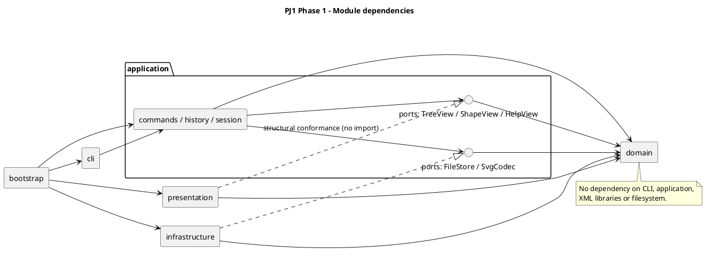

# PJ1 第一阶段：SVG CLI 编辑器设计与实现

## 架构方案

### 模块划分与职责

工程采用 TypeScript 面向对象实现，内置 rect、circle、ellipse、line、text 和 g。交互、用例协调、领域行为、展示与文件访问分别放在以下模块，具体依赖由启动入口装配。

| 模块 | 职责 | 主要实现 |
| --- | --- | --- |
| src/domain/shapes | 封装几何、样式与图形行为；统一叶子和容器操作 | Shape、五种叶子类、GroupShape、ShapeMutation |
| src/domain/document | 维护画布、全局 ID 索引、父子关系、顺序与快照 | SvgDocument、DocumentSnapshot |
| src/domain/factory、traversal | 集中图形创建，定义多态访问协议 | ShapeFactory、ShapeVisitor |
| src/application/commands | 封装编辑、文档和查询用例，返回结果而不直接打印 | Command、EditCommand、DocumentCommand、QueryCommand 及具体命令 |
| src/application/history、session | 管理撤销重做、历史屏障、当前文档和默认路径；串行执行命令 | UndoableCommand、HistoryManager、EditorSession、EditorState |
| src/application/ports | 定义应用所需的文件、SVG 编解码和展示接口 | FileStore、SvgCodec、TreeView、ShapeView、HelpView |
| src/cli | 分词、命令名分发、参数结构检查及终端输入输出 | Tokenizer、CommandDispatcher、Repl |
| src/presentation | 将图形转换为树形结构、属性明细与帮助文本 | TreeFormatter、ShowFormatter、HelpFormatter |
| src/infrastructure | 解析/生成 SVG，完成本地文件读写及临时文件替换 | FastXmlSvgCodec、SvgXmlReader、SvgWriter、LocalFileStore |
| src/bootstrap | 创建具体实现并注入依赖，启动 REPL | main.ts |

tests 按领域、应用、CLI、展示、基础设施和完整验收场景组织；examples 保存可回放脚本与 SVG。生产代码不依赖测试代码。

下图为 PlantUML 组件图，源文件见 [architecture.puml](architecture.puml)。实线表示依赖，虚线空心箭头表示满足端口契约。展示实现通过 TypeScript 结构类型满足接口，不导入 application。

### 设计模式的选择与落地

| 模式 | 选择原因 | 实际落地 |
| --- | --- | --- |
| Command（课程必选） | 把用户操作封装为对象，统一执行和历史策略 | 每个编辑命令有独立类；EditCommand、DocumentCommand、QueryCommand 通过多态调用会话的对应执行策略。UndoableCommand 包装一次编辑执行，保存当次结果和快照；HistoryManager 管理两个历史栈。 |
| Composite | 让容器与叶子支持相同编辑协议 | Shape 声明 move/scale/set/clone/accept；叶子处理自身几何，GroupShape 递归处理子孙。命令调用统一领域操作；删除组删除整棵子树。 |
| Memento | 分组、跨父级迁移和删除需要精确恢复位置、顺序与样式 | DocumentSnapshot 通过各图形的 clone 生成独立副本；undo/redo 恢复执行前后快照，不借助 SVG 或 JSON 序列化。 |
| Factory | 避免 CLI 创建与 SVG 导入各维护一套类型判断 | ShapeFactory 的同一类型映射负责六种图形的构造与导入缺省值；属性检查委托图形的 set 白名单。 |
| Visitor | 展示和导出需要读取不同几何字段，又不能重复按类型分派 | Shape.accept 调用 ShapeVisitor 对应方法；TreeFormatter、ShowFormatter、SvgWriter 和编辑反馈 Visitor 分别生成展示、XML 与摘要。 |

一次编辑的调用顺序为 Repl → Tokenizer → CommandDispatcher → EditorSession → EditCommand → SvgDocument/Shape。编辑先在候选文档执行，快照与反馈全部准备成功后提交；失败不改变当前文档、路径、历史或 redo。GroupShape 也先准备全部几何更新再应用，避免递归后部溢出导致部分修改。

成功编辑形成一个历史单元，包含成功但无变化的操作；成功新编辑清空 redo。成功 init/read/save 或 canvas 修改清空并锁定历史，下一次成功编辑解锁。查询使用独立副本，不进入历史，也不解除屏障。EditorSession 排队执行异步命令，文件读写不会被后续输入越过。

上述选择有明确代价：完整快照每次编辑需要约 O(N) 的复制与存储，查询副本也有 O(N) 成本；Visitor 在新增类型时需要扩展访问协议。本阶段优先保证精确恢复、状态隔离和六种固定类型的可验证性。

### 依赖方向规则

| 模块 | 允许依赖 | 原因与边界 |
| --- | --- | --- |
| domain | 自身与必要的语言标准能力 | 保持领域行为独立，不依赖应用、终端、文件系统或 XML 库。 |
| application | 自身、domain 和自身 ports | 通过接口表达外部需求，不依赖具体展示或基础设施。 |
| presentation | 自身和 domain | 只读取并格式化，不编辑文档、不访问文件；结构类型契约不产生对 application 的导入。 |
| cli | 自身、application、必要时 presentation；终端所需 Node 标准库 | 只解析、装配命令和输出；不直接编辑领域对象或读写 SVG。当前展示实现由 bootstrap 注入。 |
| infrastructure | 自身、application/ports、domain 及 XML/文件库 | 实现端口，不依赖 CLI、具体应用命令或展示模块。 |
| bootstrap | 装配所需的各模块公开入口 | 集中选择具体实现，不承担领域规则或编辑算法。 |

文档树的可变关系只由 SvgDocument 维护。TreeAccess 的 Symbol 协议是领域内部提交约定，命令不得导入它绕过索引。跨模块违规依赖必须登记为待处理项，不能通过修改自查措辞默认为允许。

### 变化点假设

| 可能变化的部分 | 已留下的边界 | 当前未实现的扩展及理由 |
| --- | --- | --- |
| 新命令 | 具体 Command 类与集中 CommandDispatcher | 分发器的命令名映射标记为待重构点；本阶段不实现动态命令注册。 |
| 新图形与 box 插件 | Shape 多态协议、集中 ShapeFactory、Visitor | 工厂的类型名映射标记为待重构点；未来需要 ShapeProvider 和可扩展访问协议，当前不能宣称插件加入无需修改内核。 |
| GUI 或 agent 输入 | 应用命令与 EditorSession 不依赖终端 | 本阶段不实现 GUI、网络或鼠标交互。 |
| 展示格式 | 独立 Formatter 与应用展示端口 | 不增加主题、国际化等无当前需求的功能。 |
| SVG 库或文件存储 | SvgCodec、FileStore 端口 | 不实现数据库、云存储等额外适配器。 |
| 导入范围 | 根属性检查、集中图形工厂与拒绝测试 | 使用已确认的六类型 SVG 子集；不支持 transform、未知元素/属性和非恒等 viewBox，避免静默丢失内容。 |
| 撤销性能 | HistoryManager 与 DocumentSnapshot 边界 | 没有性能证据前保留完整快照，未来可替换为局部快照或逆操作。 |

## 过程记录

开发过程中使用 AI 协作生成方案、实现和测试，再以需求、实际输出与失败用例校正建议。以下保留影响设计或正确性的代表性迭代。

| 时间 | 发现的问题或讨论 | 确认与处理 |
| --- | --- | --- |
| 2026-10-10 | 需求没有完全规定跨父级分组、IO 屏障、空文本与导入兼容范围。 | 先列 D01–D18；用户确认 PJ 1 为仓库根，其余采用建议。确定按文档预序分组、IO 后清空并锁定历史，以及严格 SVG 子集。 |
| 2026-10-12 | 递归几何修改若边遍历边赋值，后部节点溢出会留下部分更新。 | 增加 ShapeMutation 两步更新，测试嵌套后部溢出，确认所有节点保持原状态。 |
| 2026-10-12 | 根节点没有容器父级，仅凭 parent 无法阻止两个文档共享节点。 | 独立记录文档归属，测试跨文档共享被拒绝、删除子树解除归属后可再次使用。 |
| 2026-10-12 | 在当前文档上执行后回滚快照，虽然数值恢复，却可能替换失败前的对象引用。 | 改为候选文档执行、全部成功后提交；测试失败时原对象、索引、父级、路径与 redo 保持不变。 |
| 2026-10-12 | 分组创建允许位于根级，但用户 ungroup 禁止解散根级组，不能简单把 ungroup 当成撤销。 | 继续用快照撤销分组；混合迁移、排序和解组序列可完整 undo/redo。 |
| 2026-10-13 | CLI 若不初始化文档就无法验证编辑链；文本 “in” 又可能与父容器子句重名。 | 将无文件 IO 的 init/canvas 提前接入 CLI；Token 保留引号信息，只在参数尾部识别未加引号的 in 子句。 |
| 2026-10-13 | 导入补 ID 可能撞上后方显式 ID，XML 自动数值转换与重复解码可能改变内容。 | 先收集全部显式 ID，再按预序补号；保留字符串并逐值解码一次，验证中文、空白、特殊字符和深层嵌套的往返。 |
| 2026-10-13 | 只验证内存回滚，不能证明保存失败不会损坏原文件。 | 同目录独占临时写入并刷盘后替换；模拟写入、sync、rename 失败，检查旧内容保留和临时文件清理。 |
| 2026-10-16 | 简化演示不能代替完整课程会话，源码入口通过也不能代表编译入口通过。 | 从课程原文提取两段会话逐行断言；分别回放源码与编译入口，再启动独立进程读回保存结果。 |
| 2026-10-16 | 自动浏览器工具不能直接访问本地 SVG。 | 用户在本机打开产物并回传截图，检查图形、颜色、中文、节点位置和连线；明确记录截图来自用户。 |

## 一致性自查

### 模块划分是否与方案一致

实际 src 中六个顶层模块与方案一致；图形、文档、历史、会话、展示和文件访问均位于预定目录。没有把 XML 或文件 IO 放入领域层，也没有让命令直接拼接可变 children。

实施中有两项细化：应用 ports 增加 TreeView/ShapeView/HelpView，供查询命令接受展示能力；无文件 IO 的 init/canvas 从持久化步骤提前到 CLI 步骤。前者保持原依赖方向，后者只调整实现顺序。两项均已记入过程及修订记录，没有改变模块职责。

2026-10-16 检查 src 的 63 个 TypeScript 文件：56 个导出类均为一类一文件且类名与文件名一致；其余文件承载接口、类型、内部 Symbol 或启动装配。抽查 Shape、GroupShape、SvgDocument、EditorState 和历史对象，状态字段私有，外部子列表只读且冻结；图形行为通过类和多态实现。

### 依赖方向是否被违反

对 259 处静态导入按所在模块及解析目标进行核对，未发现违反上述依赖规则的导入。基础设施对应用的依赖限定在 application/ports；当前没有待处理的依赖违规项。代表性抽查如下：

| 文件 | 依赖与检查结果 |
| --- | --- |
| [SvgDocument.ts](../src/domain/document/SvgDocument.ts) | 只依赖领域图形、校验、快照和内部 TreeAccess，不导入应用、Node 文件或 XML 库。 |
| [EditorSession.ts](../src/application/session/EditorSession.ts) | 只依赖应用命令、状态、历史与领域文档，不持有具体文件实现。 |
| [ReadCommand.ts](../src/application/commands/ReadCommand.ts)、[SaveCommand.ts](../src/application/commands/SaveCommand.ts) | 通过 FileStore/SvgCodec 接口读写，不导入 LocalFileStore 或 fast-xml-parser。 |
| [TreeFormatter.ts](../src/presentation/TreeFormatter.ts) | 依赖领域对象、Visitor 和本模块样式格式器，不导入应用或文件模块。 |
| [FastXmlSvgCodec.ts](../src/infrastructure/svg/FastXmlSvgCodec.ts) | 依赖应用端口、领域对象及自身 XML 适配，不导入 CLI 或具体命令。 |
| [main.ts](../src/bootstrap/main.ts) | 只创建和装配会话、分发器、展示与文件实现，不包含编辑规则。 |

另行搜索并检查类型分派：命令名映射只在 CommandDispatcher，图形类型映射只在 ShapeFactory；CLI 创建和 SVG 导入共用后者。展示与导出走 accept/Visitor，没有重复 switch(tag) 或按图形类 instanceof 分派。异常处理中的 instanceof Error 不承担图形分派。

## 质量保证手段

### 功能完整性与失败不变性

使用 Vitest 分层测试，并执行 TypeScript strict 类型检查与生产构建。领域测试检查几何、属性白名单、ID 唯一、父级、索引、顺序、循环拒绝和快照独立性；应用测试检查一命令一撤销单元、无变化编辑、redo 清空/保留、历史屏障、路径和异步执行顺序。

CLI 子进程测试覆盖中文、引号、空文本、转义、颜色、注释、EOF 最后一行及错误后继续。SVG 测试覆盖六类型缺省值、命名空间、实体和文本空白、两遍补 ID、严格拒绝范围外输入，以及保存后读回的领域状态等价。文件故障测试分别模拟临时写入、刷盘与替换失败，确认旧文件和当前会话状态保留。

### 完整课程场景与预览

| 验收 | 检查方式与证据 | 结果 |
| --- | --- | --- |
| 课程 §6 典型会话 | 直接从要求文档提取 19 条命令，核对 32 行结果；断言保存的 5 个元素及原父级顺序 | 通过 |
| 课程 §6.1 版本 A | 提取 14 条命令，核对 22 行结果；确认节点移动撤销后位置、中文修改和 8 个保存元素 | 通过 |
| 保存产物重读 | 独立 CLI 进程执行 read/tree，核对完整树，无多余补 ID 警告 | 通过 |
| 编译入口 | dist/bootstrap/main.js 回放相同脚本并实际生成 SVG，保留输出记录 | 通过 |
| 浏览器视觉检查 | 用户回传两张实际产物截图，检查标题、颜色、中文、节点同高和连线 | 通过 |

§6 包含非法分组与 save 后 undo 两条预期错误，因此退出码 1 是通过条件，必须继续执行后续 read/tree；版本 A 退出码为 0。示例只归一化标签对齐空格，并允许版本 A 示意树遗漏的显式 stroke=black；其他数值、文字、顺序和错误按原文比较。

完整脚本、原始输出、重读记录、实际 SVG 和截图见 [验收记录](acceptance/README.md)。

### 验证结论与适用范围

2026-10-16 对提交 48381b1 创建全新 Git 检出：初始没有 node_modules 或 dist，使用独立空 npm 缓存按锁文件安装 50 个包，再执行 npm run check。类型检查通过，19 个测试文件的 520 项测试全部通过，生产构建成功。npm run cli、npm start、编译入口的两段完整课程会话及保存后读回均验证通过。

当前待提交改动仅涉及文档；源码、测试、示例和构建配置等 99 个文件已逐一核对 SHA-256，与新检出一致。复制候选文档前，新检出在安装、测试和运行后仍保持 Git 工作区干净，锁文件未修改。候选文档另行检查了章节、链接与组件图一致性。原始结果与验证方法见 [干净检出验证记录](verification/README.md)。

当前证据支持第一阶段功能与完整业务场景通过。范围限于已确认的 SVG 子集：不实现 box/插件或 GUI，不导入 transform、未知元素/属性、非恒等 viewBox、DTD 或自定义实体。完整快照的 O(N) 成本和文件替换的单机验证范围仍然存在，不能由测试通过推断任意规模或任意文件系统都具有相同行为。

上述结论包含已记录 Windows、Node.js v22.17.1、npm 10.9.2 环境下的全新检出安装与运行验证，不依赖原工作区的依赖或构建残留；其他操作系统和 Node 版本未作实测。
