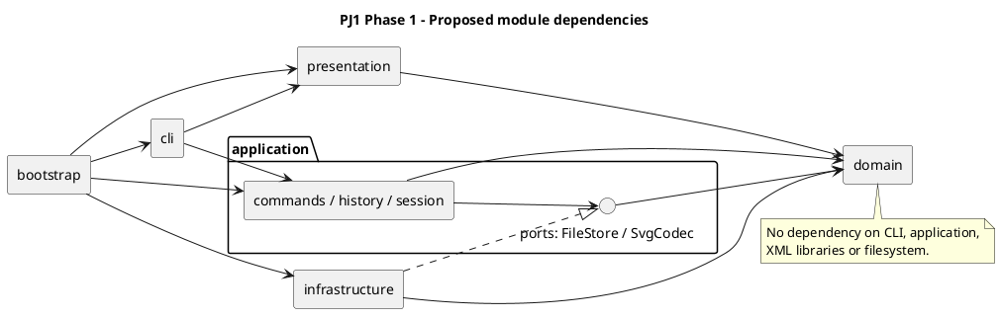

# PJ1 第一阶段：SVG CLI 编辑器架构与约定（已确认）

- 编写日期：2026-10-10。
- 需求依据：[phase_cli_1.md](../phase_cli_1.md)。
- 确认日期：2026-10-10；用户确认 D01 使用 `PJ 1` 作为仓库根目录，D02–D18 按原建议执行。
- 当前阶段：已确认架构与行为约定，尚未实现业务代码。
- 本文中的“需求”来自阶段文档；“方案”及第 5 节的“已采纳规则”是本次确认后的实施依据；替代方案仅保留为取舍记录。
- 所有原有不确定事项集中在第 5 节，决策依据记录于第 7 节。D15 的具体依赖版本及 D18 的实际截止时间属于仍需补充的实施信息，不影响本轮建仓。

## 1. 范围与固定要求

### 1.1 本阶段范围

实现 TypeScript 面向对象 SVG 命令行编辑器，支持六种内置类型：`rect`、`circle`、`ellipse`、`line`、`text`、`g`。

| 分类 | 命令 | 历史行为 |
| --- | --- | --- |
| 文档 | `init`、`read`、`save`、修改尺寸的 `canvas` | 成功执行后禁止 undo/redo，直到下一次编辑重新解禁 |
| 编辑 | `create`、`delete`、`move`、`scale`、`set`、`group`、`ungroup`、`addto`、`front`、`back` | 一条成功编辑命令是一个撤销单元 |
| 显示 | `tree`、`show`、`help`、查询尺寸的 `canvas` | 不进入编辑历史 |
| 历史 | `undo`、`redo` | 新编辑发生后清空 redo 栈 |

`box`、插件加载系统、GUI、鼠标操作不在本阶段实现范围。`create box` 必须返回未知图形类型错误。需求中的复合图形专用 ungroup 错误属于后续阶段语义，本阶段不为此增加一个可创建的 box 类型。

### 1.2 固定交互与模型约束

1. REPL 使用 `svg>` 提示符，逐行读取输入。
2. 每个图形及 `g` 都有全局唯一、大小写敏感的 ID；画布根不是可编辑图形。
3. CLI 的 `create/group` 必须显式提供 ID；导入时缺失 ID 按标签名加序号补全并警告。
4. 坐标采用 SVG 坐标系，支持浮点数。
5. 带空格参数使用双引号。文本内容是 XML 子文本，不是 SVG 属性。
6. 错误一行一条，以 `error:` 开头；命令失败不改变任何状态。
7. 编辑成功输出结果摘要；显示命令输出对应内容。
8. `create ... in <containerId>` 支持全部六种类型；省略时挂到画布根。
9. 删除容器删除全部子孙；移动容器整体移动；缩放容器递归到子孙。
10. `scale` 同时缩放图形的位置与尺寸，因子必须为正数。
11. 样式省略时不写入属性，遵循 SVG 默认渲染行为。
12. `set` 只支持公共样式和各类型规定的几何属性，以及 text 的 `text` 内容；不支持通过 set 修改 ID。
13. `ungroup` 将子节点提升到原父容器中，占据原组位置；禁止解散 SVG 根的直接子容器。
14. `front/back` 只调整同级节点的绘制顺序。
15. 一类一文件，文件名等于类名；字段封装；几何行为通过类与多态实现。
16. 不采用公共数据袋加过程式函数的领域模型，不在各模块重复 `switch(tag)`。
17. 按名称分派只集中在命令分发与图形工厂两处，并在设计中标注为待重构点。

需求规定的错误字符串将直接作为测试依据，包括重复 ID、不存在的图形或容器、非容器目标、未知类型、非法分组、根级解组、非正缩放、文件读写失败、无文档和历史屏障。文档未规定的错误见 D12。

## 2. 架构方案

### 2.1 目录与模块职责

已确认工程与 Git 仓库根目录均为 `D:\Code\Software_Design\PJ 1`，不在上级 `Software_Design` 目录建仓。

```text
PJ 1/
├── src/
│   ├── domain/
│   │   ├── shapes/           # Shape、各叶子图形、GroupShape
│   │   ├── document/         # SvgDocument、ID 索引、文档快照
│   │   ├── factory/          # ShapeFactory：唯一的图形名称分派点
│   │   └── traversal/        # ShapeVisitor 等只读遍历协议
│   ├── application/
│   │   ├── commands/         # Command 与每个具体命令类
│   │   ├── history/          # HistoryManager、历史屏障
│   │   ├── ports/            # FileStore、SvgCodec 接口
│   │   └── session/          # EditorSession：当前文档、路径、执行协调
│   ├── cli/                 # Tokenizer、CommandDispatcher、Repl
│   ├── presentation/        # TreeFormatter、ShowFormatter、HelpFormatter
│   ├── infrastructure/
│   │   ├── svg/             # XML 解析、SVG 读写 Visitor、SvgCodec 实现
│   │   └── filesystem/      # FileStore 的本地实现
│   └── bootstrap/           # 启动入口、具体依赖装配
├── tests/                   # 领域、应用、端到端测试和输入样例
├── examples/                # 命令脚本与可预览 SVG
├── doc/
│   ├── README.md            # 本文：方案、决策、过程、自查、质量保证
│   └── architecture.puml    # 架构图源文件
├── README.md                # 安装、运行、测试、示例
├── package.json
└── tsconfig.json
```

该目录是设计目标，不表示文件或类已创建。命令、快照、Visitor 等具体类名可以在实现时调整，但职责和依赖方向改变必须记录。

### 2.2 架构图

箭头表示左侧依赖右侧；端口属于应用层，基础设施实现端口。图源同时保存在 [architecture.puml](architecture.puml)。



### 2.3 依赖方向规则

| 模块 | 允许依赖 | 禁止依赖及原因 |
| --- | --- | --- |
| domain | 本模块和必要的语言标准能力 | 不依赖其他业务模块、Node 文件系统或 XML 库，保持领域行为独立 |
| application | domain、自身 ports | 不依赖 CLI、展示实现或具体基础设施，避免业务绑定输入输出方式 |
| presentation | domain | 不执行编辑、不读写文件，输出格式不影响业务状态 |
| cli | application、presentation | 不直接编辑领域对象，不读写 SVG 文件，不维护历史 |
| infrastructure | application/ports、domain、XML/文件库 | 不依赖 CLI、presentation 或具体应用命令 |
| bootstrap | 各模块的装配所需公开入口 | 不承载编辑规则和命令实现 |

跨模块仅通过明确的公开接口访问。测试可导入被测模块，但生产代码不得依赖测试。违反规则的依赖登记为待处理项，不能在自查时默认为允许。

## 3. 对象职责与设计模式

### 3.1 领域对象与 Composite

- `Shape`：封装 ID、公共样式，声明 `move/scale/set/accept/clone` 等统一协议。
- `RectShape/CircleShape/EllipseShape/LineShape/TextShape`：持有私有几何字段，实现自己的校验和几何行为。
- `GroupShape`：封装有序子节点，对 move/scale 递归调用统一协议；set 只改变容器自身样式，由 SVG 继承生效，不覆盖子节点显式样式（D07）。
- `SvgDocument`：封装画布、根节点集合、全局 ID 索引；提供插入、删除、迁移、查询与结构操作。

父子关系、索引和顺序只允许通过领域操作维护，不能让命令拿到可变 children 数组后自行拼接。父引用的具体表示可在实现时决定，但必须保证一节点一父级、无循环、索引与树一致。

组合操作规则先由文档验证和协调，再委托图形多态行为；不让每个命令重复识别图形类型。容器本身没有 x/y 等几何属性，不因统一接口而给 g 虚构坐标。

### 3.2 Command（课程必选）

每种编辑操作对应具体 Command 类。一条命令执行一次，形成一个历史单元。`HistoryManager` 负责 undo/redo 栈，不参与具体几何或结构规则。

文档与显示命令也通过应用层执行入口协调，但不加入编辑历史。命令分类是对象协议或元数据，不能通过反复比较命令名推断历史行为。

典型调用链：

```text
REPL → Tokenizer → CommandDispatcher → EditorSession
     → Command → SvgDocument / Shape
     → HistoryManager → CLI 输出
```

应用层返回结构化结果；CLI/展示层负责输出文字。领域对象不打印日志、不读取用户输入。

### 3.3 Memento 与撤销方案（已采纳 D02）

采用 Command 配合完整文档快照：命令执行前后保存领域快照，undo 恢复前状态，redo 恢复后状态。快照是封装对象，通过各类 clone 能力复制，不通过 JSON 序列化丢失类行为，也不通过 SVG 文件读写生成快照。

优点是复杂分组、跨父级迁移和删除子树可精确恢复；代价是每次编辑约为 O(N) 的复制时间和存储开销。课程规模下建议优先采用该方式，后续确有性能需求时替换成局部快照或逆操作。

命令验证失败不得提交快照到历史；新编辑只有成功后才能清空 redo 栈。成功 IO 清空 undo/redo 栈并锁定历史；下一次成功编辑解锁，不能跨 IO 屏障撤销（D03）。

### 3.4 Factory 与名称分派限制

- `CommandDispatcher`：唯一的“命令名 → 命令创建逻辑”分派点。
- `ShapeFactory`：唯一的“类型名/标签名 → 图形类创建逻辑”分派点，CLI 创建和 SVG 导入共用。

两个分派点均标记为后续待重构：命令注册机制、ShapeProvider 类型注册接口是未来方向，本阶段只内置要求的命令和六种类型。

图形工厂可将不同输入转换为封装的创建请求，但不把文件读写和终端输出塞进工厂。SVG 导入遇到支持的标签后调用同一工厂；XML 库的节点种类处理不等于新增一套图形类型分派。

### 3.5 Visitor 用于只读展示与序列化

建议在领域层定义 `ShapeVisitor` 协议，各图形通过 `accept` 调用对应访问方法。`TreeFormatter`、`ShowFormatter`、SVG Writer 在各自模块实现该协议。

这样展示和导出无须 `switch(tag)`，领域类也不依赖具体 XML 库或 CLI 字符串。取舍是新增图形类型可能需要扩展 Visitor 接口；本阶段只有六种固定类型，可接受这一成本。未来插件阶段应重新评估动态类型与 Visitor 的兼容方式，不宣称当前方案已实现“插件新增内核代码为零”。

## 4. 状态、事务与变化点

### 4.1 必须保护的状态

失败原子性覆盖当前文档、画布尺寸、图形字段、父子关系、绘制顺序、ID 索引、默认文件路径、undo/redo 栈和历史屏障状态。

建议执行顺序为：解析参数 → 校验全部前置条件 → 准备候选状态 → 提交状态与历史 → 输出成功结果。读取文件应先构建并验证临时文档，成功后替换当前文档。自动补 ID 的警告建议在完整导入成功后集中输出，避免失败导入给人已生效的印象。

保存操作对外部文件的保护方式见 D14；不能把内存原子性等同于磁盘写入原子性。

### 4.2 变化点假设

| 可能变化的部分 | 本阶段留下的边界 | 暂不做的扩展及理由 |
| --- | --- | --- |
| 新命令 | Command 对象、集中分发 | 不做动态插件加载，当前命令集合固定 |
| 新图形/box | 统一 Shape、Composite、集中工厂 | 不提前实现 ShapeProvider；插件协议需结合后续要求设计 |
| GUI/agent 输入 | CLI 与应用层分离 | 不写 GUI、网络服务或鼠标事件 |
| SVG/XML 库或存储方式 | SvgCodec/FileStore 端口 | 不添加数据库和云存储适配器 |
| tree/show 格式 | 独立展示模块与 Visitor | 不实现主题或国际化系统 |
| 撤销性能 | HistoryManager 与快照边界 | 不先做增量优化；确认性能问题后再替换 |
| 导入范围 | 显式支持矩阵与读写测试 | 不宣称兼容任意外部 SVG |

## 5. 已确认决策（集中清单）

用户于 2026-10-10 明确确认：“D01 PJ 1作为仓库根目录；其他按照建议的来。”以下 D01–D18 均已采纳，执行时以“已采纳规则”为准。替代方案不参与当前实现，后续变更需记入修订记录。

| 编号 | 决策事项 | 已采纳规则 | 未采纳的替代方案与影响 |
| --- | --- | --- | --- |
| D01 | 仓库根目录 | 使用 `PJ 1/` 为独立仓库根 | 使用整个 `Software_Design/` 会把其他课程项目纳入本仓库，需额外目录约定 |
| D02 | 撤销实现方式 | Command + 完整领域快照；先保证精确恢复 | 每命令局部快照/逆操作，内存更低，但结构命令实现与验证更复杂 |
| D03 | IO 屏障后是否保留旧历史 | 成功 IO 后清空两栈并锁定；下一次成功编辑解锁，undo 仅能回到该 IO 后状态 | 保留旧历史、解锁后允许跨屏障撤销；需明确 read/init 换文档后旧命令如何安全执行 |
| D04 | 跨父级 group 的新组位置 | 同父级：原父级中最早被选节点的位置；跨父级：画布根中最早涉及的根节点之前 | 跨父级统一放根末尾更简单；放最低公共祖先更自然，但定位规则更复杂 |
| D05 | group 的“保持相对顺序”如何解释 | 所有目标按操作前文档深度优先顺序排列；拒绝重复 ID 和祖先/子孙同时参与 | 按参数顺序排列更易手工控制，但可能不符合“保持相对顺序”的要求 |
| D06 | 分词转义和空字符串 | 支持 `\"`、`\\`；允许 `""` 作为空文本；未知转义报错；仅整行首个非空白字符为 # 时是注释 | 完全不支持转义更简单，但无法自然输入带引号文本；行内注释会与颜色值冲突 |
| D07 | g 的 set 样式语义 | 只设置 g 自身的 fill/stroke/stroke-width，由 SVG 继承生效；已有子元素显式样式保留 | 递归覆盖子元素会改变显式样式，并增加撤销状态；文档未明确要求传播 |
| D08 | 输入数值范围与溢出 | 仅有限数值；坐标可负；画布尺寸正数；宽高/半径/stroke-width 可为零但不可负；执行前检查运算结果有限 | 要求尺寸全部正数可减少退化图形，但限制 SVG 合法的零尺寸；允许负尺寸会产生无效渲染 |
| D09 | 外部 SVG 支持范围 | 接受六种标签、规定属性、根 width/height/viewBox；支持 XML 注释和命名空间；未知元素、未知属性、非恒等 viewBox 或 transform 明确报错；根尺寸只支持数值或 px | 忽略未知内容容易丢失信息；保留未知属性或解析变换更兼容，但显著扩大范围 |
| D10 | ID 合法性与自动补全 | CLI ID 为非空、无空白字符串，保持大小写；导入先收集全部显式 ID，重复报错，缺失 ID 按各标签从 1 递增并跳过占用值；空 id 按缺失处理 | 更严格的 XML ID 规则可能限制用户命名；一次遍历补 ID 容易与后面显式 ID 冲突 |
| D11 | save 的默认路径与相对路径 | read 成功记住路径；显式 save 成功更新默认路径；init 清空路径；无路径保存且无默认路径报错；相对路径基于进程工作目录 | 显式 save 不更新默认路径也可行，但下次 save 可能写回旧文件；相对路径基于输入 SVG 目录需额外说明 |
| D12 | 未规定的错误与无文档例外 | help/空行/注释/EOF 无文档时可用；其他需要文档的命令报规定错误；新增错误使用稳定的一行英文消息 | 严格解释“其他命令”会使 help 无文档不可用，与启动提示冲突。空历史、非法参数、非法 XML 等需在实现前形成字符串清单 |
| D13 | 成功但无变化的编辑 | 视为成功编辑，进入一个历史单元并清空 redo，例如 move 0 0、已在最前的 front | 无变化不进入历史更省空间，但必须定义是否重新解锁历史、是否清空 redo；实现需更多状态比较 |
| D14 | 保存时覆盖已有文件 | 显式 save 默认覆盖；尽可能先写同目录临时文件，再安全替换目标；失败不更新路径与历史 | 直接写目标更简单，但中途失败可能损坏已有文件；自动询问覆盖会影响脚本回放。替换需验证 Windows 行为 |
| D15 | 技术工具与工程检查 | Node.js + npm；TypeScript strict；使用成熟 XML 解析库；采用 Vitest 或同等级测试框架；锁定依赖并提交锁文件 | 具体版本和 XML 库在实现前检查本机环境及维护状态后再定；手写 XML 解析风险较高 |
| D16 | CLI 退出与脚本错误 | EOF/Ctrl+C 退出；不增加课程未列出的 quit 命令；脚本中出错继续下一行，但最终进程返回非零状态 | 首错退出便于自动化定位，但不符合交互“错误后继续”的直觉；始终零退出不利于自动验收 |
| D17 | addto 自身/祖先与重复归属 | 自身或移入子孙一律报错；已属于目标容器时仍移至末尾，符合“最后一个子节点” | 已属于目标时直接报错或无变化也可，但需统一成功反馈及历史行为 |
| D18 | 最终截止时间和分支策略 | 用户提供课程截止时间；主分支使用 main；分步提交并推送，最终提交标记 final | 当前需求未给出截止时间，无法确认标签是否按时；后续如远端出现新历史，先拉取协调，禁止强制覆盖 |

D09 已确认本阶段拒绝 transform，不支持导入背景中的带变换示例。支持六种类型的 SVG 子集，不承诺兼容任意外部 SVG；后续若增加变换支持，应另行记录范围修订并补充测试。

### 5.1 SVG 导入与属性支持矩阵（落实 D09）

| 元素 | 支持的属性/内容 | 处理规则 |
| --- | --- | --- |
| svg 根 | SVG 命名空间、width、height、viewBox | width/height 为有限正数或 px；省略 viewBox 按画布尺寸解释，存在时只接受 `0 0 width height`；不为根分配图形 ID |
| rect | id、x、y、width、height、fill、stroke、stroke-width | 按 SVG 几何默认值解释缺省属性，尺寸非负 |
| circle | id、cx、cy、r、fill、stroke、stroke-width | 按 SVG 几何默认值解释缺省属性，半径非负 |
| ellipse | id、cx、cy、rx、ry、fill、stroke、stroke-width | 按 SVG 几何默认值解释缺省属性，半径非负 |
| line | id、x1、y1、x2、y2、fill、stroke、stroke-width | 坐标允许负值 |
| text | id、x、y、fill、stroke、stroke-width；子文本 | 保留文字内容与空白，不支持 tspan 等子元素 |
| g | id、fill、stroke、stroke-width；受支持的子图形 | 维护子节点顺序，拒绝 transform |

图形几何值只接受有限数值；根 width/height 缺失时因无法确定画布而拒绝。XML 声明、注释与结构缩进不作为图形；未知元素/属性不忽略、不透传，整次 read 失败且当前状态不变。SVG 标准命名空间声明属于 XML 结构信息，不作为未知图形属性。颜色字符串不做完整 CSS 解析。

### 5.2 补充错误清单（落实 D12）

需求已规定的错误文本保持不变。以下针对需求未规定的错误制定稳定输出；`<...>` 表示实际参数值。

| 情况 | 输出 |
| --- | --- |
| 未知命令 | `error: unknown command: <name>` |
| 参数数量或结构错误 | `error: invalid arguments. usage: <syntax>` |
| 引号未闭合 | `error: unterminated quoted string` |
| 未知转义 | `error: invalid escape sequence: <sequence>` |
| 非法或非有限数值 | `error: invalid number: <value>` |
| 数值范围或运算结果非法 | `error: invalid value for <attribute>: <value>` |
| 空历史（不在 IO 屏障状态） | `error: nothing to undo` / `error: nothing to redo` |
| 无默认保存路径 | `error: no save path. use 'save <file.svg>' first` |
| 非法 SVG/XML 内容 | `error: invalid svg: <reason>` |
| 导入元素或属性不支持 | `error: unsupported svg element: <tag>` / `error: unsupported svg attribute: <attribute>` |
| viewBox 不支持 | `error: unsupported svg viewBox: <value>` |
| 非法 ID | `error: invalid id: <id>` |
| group 参数含重复目标 | `error: duplicate group target: <id>` |
| addto 形成循环 | `error: cannot add a container into itself or its descendant: <id>` |
| ungroup 目标是普通叶子 | `error: not a container: <id>` |

错误只输出一行，底层 XML/文件异常不直接输出堆栈；多个错误同时存在时按解析、文档存在性、参数与目标校验、执行的顺序报告第一个失败原因。缺失文件/读写权限使用需求指定的 cannot read/write file 错误，非法文件内容使用 invalid/unsupported SVG 错误。

## 6. 分步实施与验收计划

以下为分步计划；D01–D18 已确认，本轮只完成文档定稿及 Git 建仓和连接，不开始业务实现。依赖版本在建立开发环境时选定，截止时间待用户提供。

| 步骤 | 工作 | 验收条件 | 建议提交主题 |
| --- | --- | --- | --- |
| 1 | 审阅本文，逐项确定 D01–D18，补充错误清单和导入矩阵 | 决策无相互矛盾，未决事项有明确影响范围 | docs: record architecture decisions |
| 2 | 检查环境、SSH、远程历史；建立工程与 Git | 不覆盖远程历史，依赖可安装，空 CLI 可启动 | chore: initialize project and tooling |
| 3 | 领域模型、ID 索引、树结构、快照能力 | 唯一 ID、无循环、删除和恢复子树正确 | feat: add SVG domain model |
| 4 | Command、HistoryManager、会话协调 | 单元粒度、undo/redo、失败不变性正确 | feat: add command history |
| 5 | create/delete/move/scale/set | 六种图形及容器行为，参数错误和撤销通过 | feat: add basic editing commands |
| 6 | group/ungroup/addto/front/back | 父级、顺序、循环检查及完整恢复通过 | feat: add structural editing commands |
| 7 | 分词、分发、REPL、tree/show/help | 引号、颜色、中文、注释、树形输出正确 | feat: add CLI and inspection output |
| 8 | SVG 编解码、文件适配、文档命令 | 导入临时验证、补 ID、round-trip、历史屏障通过 | feat: add SVG persistence |
| 9 | 集成示例、回归测试与修正 | §6 会话与 §6.1 版本 A 能回放；浏览器预览正确 | test: add acceptance scenarios |
| 10 | 更新过程记录、依赖自查、运行说明 | 文档描述符合实际代码，未通过项如实列出 | docs: complete delivery documentation |
| 11 | 干净检出验证、最终推送与标签 | final 指向最终提交，远程可见且满足截止时间 | 最终提交后创建并推送 final |

每个主题可拆成多个有意义的小提交，禁止把全部实现集中为一个最终提交。功能实现与 final 标签按后续里程碑推进。

## 7. 过程记录与修订记录

### 7.1 已发生的讨论

| 日期 | 讨论/发现 | 处理与当前状态 |
| --- | --- | --- |
| 2026-10-10 | 用户要求先阅读阶段文档并输出详细计划，不开始实现 | 已阅读需求并给出分步计划；未创建业务代码 |
| 2026-10-10 | 初步计划没有把若干模糊语义完全确定，包括历史屏障和跨父级分组 | 初版列出 D01–D18 供评审；用户随后全部确认采用建议 |
| 2026-10-10 | 需求背景有 transform 示例，但命令细则要求几何属性递归缩放 | 将导入支持范围单列为 D09，避免宣称实现了任意 SVG 读写 |
| 2026-10-10 | 多处按类型分派会违反课程范式限制 | 方案集中工厂，并建议用 Visitor 处理显示/序列化；尚未代码验证 |
| 2026-10-10 | 用户确认 PJ 1 为仓库根，其余事项按建议执行，并要求建仓连接远端 | 决策表转为已确认；落实导入矩阵与补充错误清单；本轮办理 Git，不开始业务实现 |

记录真实讨论和修正，不编造用户审阅意见、测试结果或 AI 发现过程。

### 7.2 决策与修订登记

| 决策编号/修订项 | 用户决定 | 理由 | 影响模块/测试 | 状态 |
| --- | --- | --- | --- | --- |
| D01 | PJ 1 为独立仓库根 | 用户明确指定，避免混入其他课程项目 | 工程目录、Git 管理 | 已确认 |
| D02–D08 | 采纳第 5 节规则 | 用户批准原建议；保证精确撤销、结构顺序和输入边界 | 领域、Command、history、CLI | 已确认 |
| D09–D14 | 采纳第 5 节规则，明确 SVG 子集和错误清单 | 用户批准原建议；避免静默丢失 SVG 信息并保持失败原子性 | SVG 编解码、文件、会话、验收测试 | 已确认 |
| D15–D17 | 采纳第 5 节规则 | 用户批准原建议；具体依赖版本后续依环境选定 | 工具链、REPL、结构命令 | 已确认 |
| D18 | main 为主分支，分步提交推送，最终打 final | 用户批准流程；实际截止时间尚未提供 | Git 与交付验收 | 流程已确认，截止时间待补充 |

## 8. 一致性自查

当前仅有设计文档，不存在已完成实现，以下项目均未验证。

| 检查 | 方法 | 当前状态 |
| --- | --- | --- |
| 实际目录与方案一致 | 对比 src 目录和模块职责，差异写入修订记录 | 待实现后检查 |
| 一类一文件、字段封装 | 检查类文件与可变字段访问 | 待实现后检查 |
| 依赖方向符合规则 | 抽查 imports，特别检查 domain/application 是否导入 CLI、文件或 XML 实现 | 待实现后检查 |
| 仅两处名称分派 | 搜索 switch、tag/type 比较及类型映射，人工判断是否形成重复分派 | 待实现后检查 |
| Command 与 Composite 真实落地 | 检查具体命令和容器多态行为，结合测试结果 | 待实现后检查 |
| 文档与实际行为一致 | 对照决策表、CLI 输出和 SVG 支持矩阵 | 待实现后检查 |

## 9. 质量保证手段与验收清单

采用领域测试、应用测试、CLI/文件端到端测试，并执行类型检查和构建。测试验证外部行为和领域约束，不为每个 getter 编写机械重复测试。

- [ ] 六种图形创建、属性白名单、浮点与边界数值。
- [ ] 全局 ID 大小写敏感、重复检测、删除后索引一致。
- [ ] 所有 create 类型支持 in；目标不存在或非 g 时错误正确。
- [ ] 嵌套容器 move/scale 递归，位置和尺寸同时缩放。
- [ ] set 文本与样式符合最终决定，未设置样式保持缺省。
- [ ] group 同父级/跨父级顺序、重复目标、祖先子孙冲突。
- [ ] ungroup 原位提升及根级禁止解组。
- [ ] addto 防循环，front/back 保持其他同级节点相对顺序。
- [ ] 每条编辑一个撤销单元，删除/分组/迁移可精确恢复。
- [ ] undo 后成功新编辑清空 redo；失败编辑不破坏 redo。
- [ ] 文档命令成功建立屏障；失败不改变路径、历史或文档。
- [ ] 查询和显示不进入历史、不破坏 redo。
- [ ] 引号、空格、中文、颜色、空行、注释和非法参数。
- [ ] XML 转义、命名空间、嵌套结构、绘制顺序和缺省样式。
- [ ] 缺 ID 补全及警告，不与后部显式 ID 冲突。
- [ ] 非法 XML、重复 ID、支持范围外内容、文件不存在或写入失败。
- [ ] 保存后读回的领域状态等价，不要求 XML 字节逐字一致。
- [ ] 文档 §6 完整会话和 §6.1 版本 A 流程图回放。
- [ ] create box 报未知类型；不把阶段二示例作为本阶段通过条件。
- [ ] 浏览器预览导出 SVG，检查中文、几何位置、样式与层级效果。
- [ ] 干净检出可安装、类型检查、测试、构建和运行。
- [ ] 分步 Git 历史、远程提交、final 标签和截止时间验证。

覆盖率只辅助发现遗漏。最终质量结论应填写实际运行命令、结果、已知限制和未通过项；本稿不声称任何测试已通过。
