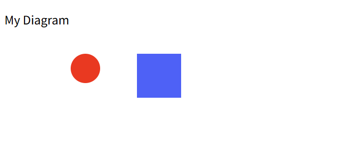

# PJ1 完整场景验收记录

验收日期：2026-10-16。依据：[课程要求 §6 / §6.1](../../phase_cli_1.md)。本轮只增加验收测试和证据，未修改生产代码。

## 自动验收结果

| 场景 | 命令数 | 对照输出行数 | 预期/实际退出码 | 结果 |
| --- | ---: | ---: | --- | --- |
| §6 完整典型会话 | 19 | 32 | 1 / 1 | 通过 |
| §6.1 版本 A 流程图 | 14 | 22 | 0 / 0 | 通过 |
| 两个保存产物重新读入 | 每个执行 read 和 tree | 全树比对 | 0 / 0 | 通过 |

§6 有意执行非法分组与 save 后 undo，必须输出两条规定错误、继续后续命令，并按 D16 最终返回非零状态。因此该场景退出码 1 是通过条件。

源码入口由 [CourseAcceptance.test.ts](../../tests/acceptance/CourseAcceptance.test.ts) 验证；命令及期望输出直接从原始课程文档提取，未把缩短后的演示脚本当作完整验收。另行以编译入口 dist/bootstrap/main.js 回放并留下本目录的原始输出和实际 SVG，结果汇总见 [results.json](results.json)。

本轮完整执行 npm run check：严格类型检查、19 个测试文件中的 520 项测试、生产构建全部通过。

## 逐项检查

| 要求/检查点 | 实际证据 | 结果 |
| --- | --- | --- |
| 创建、分组及原始 tree | §6 前九条命令及整棵树输出逐行比对 | 通过 |
| move / undo / redo | c1 的位置依次为 (130,100)、(100,100)、(130,100) | 通过 |
| set 文本并撤销 | 修改为 My Diagram v2 后恢复 My Diagram | 通过 |
| 非法分组失败且继续执行 | 按原文输出祖先/子孙冲突错误，随后 delete 和 undo 正常 | 通过 |
| 删除与完整恢复 | box 恢复到 markers 内原位置；保存文件中顺序为 c1、box | 通过 |
| save 及历史屏障 | demo.svg 含 5 个元素，随后 undo 输出规定屏障错误 | 通过 |
| read / 补 ID / 警告 | other.svg 含 7 个元素；只对缺失 ID 的 rect 输出 rect1 警告；末尾 tree 完整匹配 | 通过 |
| 所有层级的创建归属 | flowchart → node1/node2 → rect/text，连线直属 flowchart | 通过 |
| 容器移动和撤销 | 节点 2 下移后撤销；最终矩形为 (520,100)，文本为 (545,135) | 通过 |
| 中文修改及保存 | 处理数据 v2 完整保存，flowchart.svg 含 8 个元素 | 通过 |
| 保存后读回 | 独立 CLI 进程重新 read、tree，无补 ID 警告，树与保存领域状态一致 | 通过 |

对输出只做两项有记录的处理：忽略示例中标签后的对齐填充空格；§6.1 的示意树省略了创建时显式给定的 stroke=black，允许实际输出保留该属性。文字、坐标、样式值、结构连接符、节点顺序、其他成功摘要与错误文本均按原文比较。

## 浏览器预览与截图

自动浏览器工具拒绝访问本地 file:// 文件，并禁止绕过。用户在本机打开实际产物后回传两张预览截图；以下视觉结论来自对用户截图的检查，没有将其记作代理自动浏览器测试。

| 产物 | 视觉检查 | 结论 |
| --- | --- | --- |
| [demo.svg](demo.svg) | My Diagram 标题正常；红色圆、蓝色矩形均显示，位置关系与 SVG 坐标一致 | 通过 |
| [flowchart.svg](flowchart.svg) | 蓝/橙节点和中文“开始 / 处理数据 v2”显示正常；两个节点在同一水平线，黑色直线连接左右节点边缘 | 通过 |

截图为图形区域，未包含浏览器工具栏，未记录浏览器型号或缩放比例。画布尺寸、精确几何和层级由自动断言及实际 SVG 验证。




## 复现与产物

在项目根目录运行自动验收：

```powershell
npm test -- tests/acceptance/CourseAcceptance.test.ts
```

编译后回放原始脚本（本目录已有会被覆盖的验收 SVG）：

```powershell
npm run build
Set-Location doc/acceptance
$OutputEncoding = [System.Text.UTF8Encoding]::new()
Get-Content -Raw -Encoding UTF8 session.cli | node ../../dist/bootstrap/main.js
# 此时预期 $LASTEXITCODE 为 1：两条错误是需求场景的一部分
Get-Content -Raw -Encoding UTF8 flowchart.cli | node ../../dist/bootstrap/main.js
# 此时预期 $LASTEXITCODE 为 0
```

- [session.cli](session.cli)、[session.stdout.txt](session.stdout.txt)、[session.reloaded.txt](session.reloaded.txt)：§6 原文命令、实际输出和保存后重新读入记录。
- [flowchart.cli](flowchart.cli)、[flowchart.stdout.txt](flowchart.stdout.txt)、[flowchart.reloaded.txt](flowchart.reloaded.txt)：版本 A 原文命令、实际输出和重新读入记录。
- [other.svg](other.svg)：原文外部输入；[demo.svg](demo.svg)、[flowchart.svg](flowchart.svg)：编译入口实际生成的产物。

本目录 flowchart.svg 严格对应版本 A 中 move 后 undo 的结果，节点 2 回到 y=100。项目 examples/flowchart.cli 是额外演示，包含 redo，因而其 examples/flowchart.svg 中节点 2 位于 y=200；两者对应不同命令序列。

## 后续交付事项

本轮完整场景与视觉验收通过，未发现需要修改生产代码的问题。最终交付文档统一整理、干净检出安装验证、最终提交与 final 标签仍按后续步骤办理；本轮尚未提交推送。
