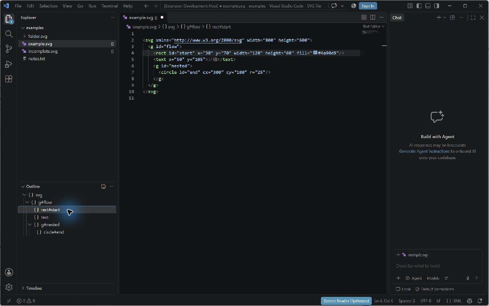
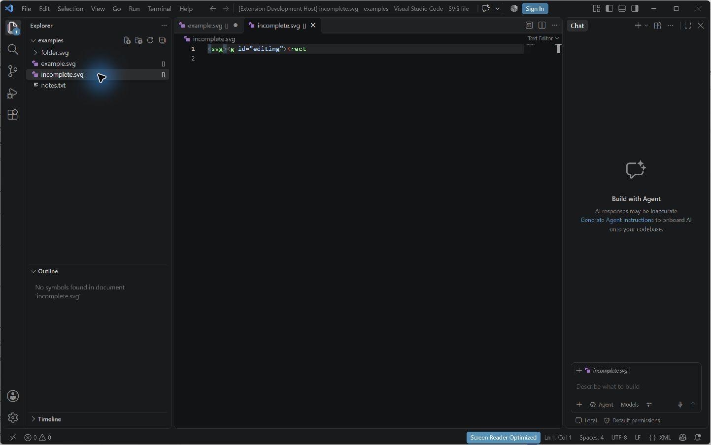

# VS Code SVG 插件实践

完成日期：2026-11-07。对应第二阶段 A.1–A.3。扩展源码与安装启动说明见 [extensions/svg-tools](../../../extensions/svg-tools/README.md)。

## 先观察原生大纲

实现前在已有 VS Code 窗口打开 GroupShape.ts，展开原生 Outline，观察类、属性、构造函数与方法的层次，以及右侧源码和大纲节点之间的关系。由此选择让扩展提供 DocumentSymbol 树和源码范围，保留宿主负责的大纲布局、折叠、选择与导航，不另建自定义树视图或 Webview。

## 职责与调用过程

| 对象 | 职责 |
| --- | --- |
| VS Code | 管理 Explorer、文本缓冲区、原生 Outline、符号请求、行列转换和点击导航；管理扩展激活与 Disposable 生命周期。 |
| extension.ts | 激活时创建两个 provider，注册到 VS Code，并将注册句柄、文件 watcher 和 provider 交给 context.subscriptions。 |
| SvgDecorationProvider | 对后缀为 .svg（大小写兼容）的 URI 查询 workspace.fs.stat；只对普通文件返回 []，目录、非 SVG、缺失文件和取消请求不装饰；不向父级传播。 |
| OutlineParser / OutlineElement | 用 saxes 事件解析当前字符串，封装标签、可选 ID、父子层次及 UTF-16 源码偏移；XML 不完整时返回空结果。 |
| SvgSymbolProvider | 把中间树适配为 DocumentSymbol，使用 TextDocument.positionAt 建立 range 和 selectionRange；每次从当前缓冲区重新解析，避免旧缓存。 |

调用方向分别为：宿主 Explorer → FileDecorationProvider → workspace.fs.stat → FileDecoration；宿主 Outline → DocumentSymbolProvider → 当前 TextDocument → XML 中间树 → DocumentSymbol。编辑后 VS Code 重新请求符号，点击节点由宿主按照 selectionRange 定位。

注册在 onStartupFinished 激活后完成，因此无需先打开 SVG 才能出现文件标记。文件创建、删除或变化触发装饰刷新；所有事件和注册均可释放。扩展从不通过重命名、写入图形内容或给元素补 ID 来制造界面效果。

## 与 Decorator、Adapter 的对应和差异

文件装饰的相似之处是给已有文件条目附加界面职责，保留原始名称和内容；宿主组合文件条目和 provider 返回的 badge、tooltip 元数据。

但它不等同于经典 GoF Decorator：SvgDecorationProvider 没有持有一个同接口的被包装文件组件，也没有在相同操作接口上逐层委托。这里的“装饰”是宿主开放的元数据 provider 契约，组合主要发生在宿主，不应仅因 API 名字含 Decoration 就宣称实现了完整的对象装饰器结构。

Adapter 对应关系更明确：宿主要求 FileDecorationProvider 接口，provider 把 workspace.fs.stat 的文件类型信息转换为 FileDecoration；宿主要求 DocumentSymbolProvider，SvgSymbolProvider 把 XML 中间树的标签、ID、偏移和 children 转换为 VS Code 的符号、范围和层次。适配器让宿主无需理解 XML 解析器的事件和内部对象。

未将这些 VS Code provider 当成后续 CLI 的四个扩展点；它们分别服从 VS Code 自己的接口和生命周期。

## Phase 1 复用评估

| 已有部分 | 结论与原因 |
| --- | --- |
| SvgXmlReader / FastXmlSvgCodec | 不直接复用。它们实现严格的六类型编辑器子集，检查画布、未知属性、几何值和唯一 ID；还会补 ID。大纲需要显示缺尺寸、重复/缺失 ID、path/tspan/transform 等普通 XML 结构，且必须保留源码位置。原解析结果不带完整源码范围。 |
| Shape / SvgDocument / ShapeFactory | 不直接复用。领域模型描述可编辑图形及归属不变量，没有对应源码区间；用它构建大纲会增加无关的编辑约束，并可能把未保存源码规范化。 |
| ShapeVisitor / TreeFormatter | 复用层次遍历思想，不直接导入。原 Visitor 只列六种固定图形且输出 CLI 文本，原生 Outline 需要任意 XML 元素的 DocumentSymbol 树。 |
| 数字、XML 转义等工具 | 本功能不处理几何数值或写出 XML，直接复用收益很小。位置/实体处理由保留位置信息的解析库承担，避免复制整套 CLI 模块。 |

因此实现独立的轻量解析和适配层，没有为了追求代码复用而扩大 CLI 的导入范围，也没有改动第一阶段生产代码。

## 校验与实际界面证据

本机 VS Code 1.145.0；扩展声明兼容 VS Code 1.85 及以上，其他版本尚未逐一实测。

| 验证 | 结果 |
| --- | --- |
| 独立 TypeScript strict 检查及 esbuild 打包 | 通过；VS Code API 保留为宿主依赖，saxes 打入运行包。 |
| 17 项单元测试 | 嵌套、无 ID、根/叶子范围、当前文本更新、错误 XML 与恢复、注释/CDATA/属性内大于号、CRLF/emoji/命名空间偏移、非 CLI 子集、取消请求和装饰排除规则均通过。 |
| 真实 Extension Development Host | 真实激活和符号注册通过；样例层次正确，初始 rect#start 位于第 3 行；未保存编辑更新、不完整 XML 清空、修复恢复通过；文件装饰真实 stat 与原文件 SHA-256 不变通过。 |
| 界面点击 | 先发现默认图片编辑器会抢占大纲定位；补入扩展的文本编辑器默认关联后重新验证通过。 |
| 第一阶段回归 | 520 项测试、类型检查、构建，以及六组逐字节兼容基线均通过。 |

截图中的 example.svg 缓冲区在首行插入了未保存空行，因此 rect#start 显示于第 4 行。点击大纲后右侧选中同一行，说明符号范围随当前缓冲区更新；磁盘原样例仍位于第 3 行，真实宿主测试据此断言初始行号。

## 实现中检查与修正

普通 API 测试能证明符号范围和编辑更新，但不能代替原生界面点击。首次界面检查发现本机内置图片预览会在大纲点击后重新接管 SVG。扩展现通过 configurationDefaults 给 SVG 提供普通文本编辑器默认关联，不写入用户配置文件；用户显式设置仍优先。已打开的图片预览需先 Reopen as Source Text，再观察源码大纲。

参考：[VS Code provider 与 DocumentSymbol API](https://code.visualstudio.com/api/references/vscode-api)、[原生符号功能](https://code.visualstudio.com/api/language-extensions/programmatic-language-features#show-all-symbol-definitions-within-a-document)、[configurationDefaults 机制](https://code.visualstudio.com/updates/v1_63#_configuration-defaults-overrides)。

此步骤只完成 VS Code 实践，CLI 插件式框架与四个扩展点尚未实现。扩展可独立安装依赖、构建、测试和运行，不计入后续 CLI 重构指标。
